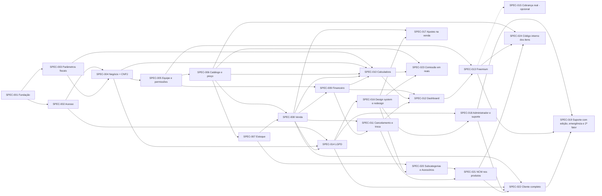

# Mapa de Specs — HealthEnterprise (HE)

> **Status:** ✅ **Aprovado pela equipe em 02/10/2026** (revisão 2 — escolhas de ordenação confirmadas, inconsistências corrigidas e questões em aberto decididas, seção 1.7). **Revisão 3 (03/10/2026):** revisão de consistência da baseline antes da implementação, com as decisões OPEN-12 a OPEN-31 (seção 1.8), adotadas pela equipe em todas as Specs implementadas (SPEC-001 a SPEC-014, SPEC-016 e SPEC-017). As Specs foram geradas uma por vez, sob pedido; o andamento está na seção 4. Gerado conforme `docs/Prompt_SDD_Specs.pdf`.
>
> **Baseline utilizada:** `VISAO_DE_NEGOCIO.md`, personas v2, `requisitos.md` (RF01–RF73, RN01–RN29, RNF01–RNF11), `requisitos_ears.md`, modelo de domínio e jornadas, casos de uso, diagramas comportamentais, modelo lógico, `schema.prisma`, drivers arquiteturais, ADR-001 a ADR-006, guia de issues e README.
>
> **Convenção:** a baseline usa **RN** (Regra de Negócio) para o que o prompt chama de **RB**.

---

## 1. Análise da baseline

### 1.1 Principais comportamentos do sistema

1. Acessar o sistema com segurança (cadastro, login, sessão única entre negócios).
2. Cadastrar o negócio com enquadramento fiscal (CNPJ → CNAE → regime/Anexo).
3. Montar a equipe com papéis e permissões.
4. Manter o catálogo de produtos e serviços (com materiais) e definir o preço oficial.
5. Controlar o estoque (entradas, saídas manuais, alertas e mínimo sugerido).
6. Registrar vendas multi-itens com pagamento misto e parcelado, integradas a estoque e financeiro.
7. Gerir o financeiro (caixa, contas a pagar/receber, despesas fixas recorrentes).
8. Calcular o preço sugerido pelo markup completo com imposto do Simples/MEI.
9. Cancelar e trocar vendas com estorno.
10. Acompanhar a saúde financeira (dashboard, semáforo, ponto de equilíbrio, projeção de caixa).
11. Diferenciar plano gratuito e pago.
12. Cumprir a LGPD (consentimento, exportação e exclusão).

### 1.2 Dependências entre comportamentos

`Fundação → Acesso → (Parâmetros fiscais) → Negócio → Equipe → Catálogo → Estoque → Venda → Financeiro → Calculadora → Cancelamento → Dashboard → Freemium / LGPD`

- A **Venda** depende do Catálogo (preço oficial — RN23) e do Estoque (validação estrita — RN06).
- A **Calculadora** depende de vendas registradas (RBT12 e CMV% — RF39, RF62), das despesas fixas (RF48, RF60) e dos parâmetros fiscais (RN17). Sem histórico, ela usa as estimativas do RF50; por isso pode vir depois da Venda sem bloquear o uso do catálogo, já que o preço pode ser definido manualmente (RF64).
- O **Dashboard** consome dados de Venda, Financeiro e Calculadora (PE e CMV%) e depende da regra de exclusão de vendas canceladas (RN25).

### 1.3 Regras de negócio e invariantes centrais

| Invariante | Origem |
|---|---|
| Todo dado operacional pertence a um único negócio e só é acessível por seus membros | RN01, RNF02, ADR-002 |
| Venda nunca é concluída com estoque insuficiente; falha implica rollback total | RF18, RN06, AD-CEN02 |
| Venda concluída = baixa de estoque + lançamento(s)/conta(s), na mesma transação | RN12, AD-RF03 |
| Saldo de caixa só contém valores efetivamente recebidos/pagos | RN14, RN22 |
| RBT12 e faturamento somam vendas não canceladas por competência | RN21, RN25 |
| Preço oficial só existe por confirmação explícita e sempre gera histórico | RN15, RN16, RF64 |
| Soma dos percentuais do markup < 100% | RN19 |
| Venda nunca é apagada; cancelamento reverte estoque, contas e caixa | RN25, RN26 |
| Parâmetros fiscais não ficam em código | RN17, RNF08, ADR-004 |

### 1.4 RNFs transversais

RNF01 (web responsiva), RNF02 (multi-tenant), RNF03 (hash de senha), RNF05 (auditoria), RNF06 (< 2 s no cálculo/RBT12), RNF07 (sessão entre negócios), RNF10 (extensibilidade). Conforme o prompt, **não viram Specs próprias**: são associados às Specs em que se aplicam. A exceção é a fundação técnica (SPEC-001), justificada por ADR-001, ADR-002, AD-C01 e AD-C02.

### 1.5 Restrições e decisões já tomadas

ADR-001 (Next.js App Router + TypeScript), ADR-002 (Prisma + PostgreSQL, multi-tenant lógico por `negocioId`), ADR-003 (Supabase Auth + RBAC no servidor), ADR-004 (parâmetros fiscais em banco, RBT12 por agregação), ADR-005 (motor de precificação determinístico em TS puro), ADR-006 (consulta de CNPJ via adaptador com fallback manual). Também estão decididos: TailwindCSS/shadcn/ui (sem ADR, por ser reversível) e CI no GitHub Actions (Issue #02).

### 1.6 Inconsistências encontradas e corrigidas na baseline

| ID | Inconsistência | Resolução |
|---|---|---|
| INC-01 | Em `drivers-arquiteturais-he.md`, a tabela usava AD-QA02 = auditoria e AD-QA03 = LGPD, mas a seção de cenários usava AD-QA02 = isolamento e AD-QA03 = auditoria | Corrigido seguindo a tabela: cenário de auditoria renumerado para AD-QA02, novo cenário AD-QA03 (LGPD) e isolamento por perfil registrado como **AD-QA06** |
| INC-02 | ADR-003 dizia "Supabase Auth ou solução similar" e a Issue #04 citava Auth.js | **Supabase Auth definitivo** no ADR-003; Auth.js removido da Issue #04 |

### 1.7 Questões em aberto — decididas

| ID | Questão | Decisão | Onde foi registrada |
|---|---|---|---|
| OPEN-01 | Valores fiscais iniciais | Arquivo `docs/prisma_base/parametros_fiscais_seed.json` montado com as faixas dos Anexos I–V (LC 123/2006, redação LC 155/2016), parâmetros do MEI, margens padrão e amostra CNAE → Anexo. **Conferido em 03/10/2026:** faixas corretas e DAS atualizado para o salário mínimo de 2026 | Seed, `requisitos.md` (Próximos Passos) |
| OPEN-02 | Quem mantém os parâmetros fiscais | Arquivo de dados versionado no repositório + comando de carga, sem alterar código nem fazer deploy; tela de administração pós-MVP | ADR-004 |
| OPEN-03 | Provedores de autenticação e CNPJ | Supabase Auth (definitivo) e **BrasilAPI** atrás do adaptador, com tempo limite e fallback manual | ADR-003, ADR-006 |
| OPEN-04 | Hospedagem do banco e backup | **Supabase** (mesmo provedor da autenticação); backup diário automático + dump semanal exportado pela equipe | RNF09 |
| OPEN-05 | Fator R e multi-anexo | **Fator R automático** (folha de salários ÷ RBT12; ≥ 28% → Anexo III, senão V; aviso ao mudar); anexo único por negócio, com aviso sobre a simplificação | RF69, RN24, RN28 |
| OPEN-06 | Margens padrão por categoria | Serviços, Beleza, Saúde e Tecnologia: 32%; Produtos, Alimentação, Vestuário, Casa e Outros: 8% (Lei 9.249/1995, art. 15) | RF36, seed |
| OPEN-07 | Matriz de permissões | **Módulo × ação** (ver, criar, editar, excluir/cancelar) por módulo; os 3 papéis são predefinições; tabela completa na SPEC-005 | RF06, AD-QA06 |
| OPEN-08 | Geração das contas mensais | Rotina agendada diária (Vercel Cron) + conferência ao acessar Financeiro/Dashboard; unicidade por despesa + competência | RF67 |
| OPEN-09 | Fuso horário | Datas em UTC; dia, mês e competência em **America/Sao_Paulo** | RN29 |
| OPEN-10 | Relatórios avançados (plano pago) | Rentabilidade por item, exportação de relatórios (CSV/PDF) e histórico acima de 12 meses (dados nunca apagados) | RF47, RF70, RF71, RN18 |
| OPEN-11 | Gráfico e exportação LGPD | Gráfico: 30 dias por dia, com opção de 12 meses por mês. Exportação LGPD: .zip com JSON + CSV | RF43, RNF04 |

### 1.8 Revisão de consistência da baseline — decisões (03/10/2026)

Antes da implementação, a baseline foi cruzada com o `schema.prisma` em busca de pontos que quebrariam a implementação. As decisões abaixo foram tomadas em entrevista com a equipe e aplicadas nos documentos indicados.

| ID | Questão | Decisão | Onde foi registrada |
|---|---|---|---|
| OPEN-12 | Tabelas filhas sem `negocioId` (`MaterialServico`, `MovimentacaoEstoque`, `HistoricoPreco`, `ItemVenda`, `Pagamento`, `Parcela`) contrariavam o ADR-002/AD-C02 | `negocioId` em **todas** as tabelas operacionais, sempre igual ao do pai | Schema, modelo lógico, ADR-002, AD-C02 |
| OPEN-13 | A API REST automática do Supabase expõe o schema `public` com a chave pública | **RLS ligado em todas as tabelas, sem policies**; o Prisma (papel privilegiado) segue funcionando | ADR-002, RNF02, SPEC-001 |
| OPEN-14 | `Usuario.senha` duplicava a credencial do Supabase Auth | Sem senha local; `Usuario.id` = `auth.users.id` | Schema, ADR-003 |
| OPEN-15 | README e a Issue #01 do guia antigo divergiam na estrutura de pastas; local das Specs indefinido | `src/{app,components,lib,hooks}`, `prisma/`, `test/`; Specs em `docs/specs/` | README, IDENTIDADE_VISUAL, guia de issues, SPEC-001 |
| OPEN-16 | Buraco de centavos entre faixas do Simples (`180000` / `180000.01`) com a busca `rbt12De <= RBT12 < rbt12Ate` | Regra `rbt12De < RBT12 ≤ rbt12Ate` com limites contínuos no seed | RF38, schema, seed, ADR-004, diagrama 1 |
| OPEN-17 | Parâmetros do Fator R no seed sem tabela no schema | Nova tabela `ParametroFatorR` | Schema, seed, ADR-004 |
| OPEN-18 | Autônomo sem CNPJ sem regime tributário | Novo regime **Autônomo**, com Imposto% informado pelo usuário | RF37, RF38, RF59, schema |
| OPEN-19 | Convite de quem ainda não tem conta sem onde ser guardado | Nova tabela `Convite` (pendente/aceito/expirado/cancelado); pendentes contam no limite do gratuito | RF72, RF47, schema |
| OPEN-20 | Movimentação de estoque sem vínculo com a venda (estorno reconstruído pela receita atual do serviço) | `vendaId` na `MovimentacaoEstoque`; o cancelamento devolve exatamente o que foi baixado | Schema, diagrama 4 |
| OPEN-21 | Auditoria: a Issue #12 do guia antigo citava "tabela de Auditoria" via middleware inexistente; AD-QA02 pedia valor anterior/novo | As próprias `MovimentacaoEstoque` (com `saldoAnterior`/`saldoPosterior`) e `HistoricoPreco` são o log, somente inserção | RNF05, AD-QA02, schema |
| OPEN-22 | Imposto do Simples dividia por zero com RBT12 = 0 (negócio novo) | RBT12 proporcional (LC 123/2006, art. 18, § 2º): média dos meses × 12 ou faturamento estimado × 12 | RN21, RF39, diagrama 1 |
| OPEN-23 | Período do RBT12 (janela móvel × lei) | **12 meses anteriores ao mês do cálculo**; Fator R e CMV% usam o mesmo período | RN21, RF39, RF62, RF69 |
| OPEN-24 | Visão citava "Calculadora limitada" e "trial guiado" no gratuito, contra o RF47 | Vale o RF47: Calculadora completa no gratuito, sem trial | Visão §8.1, RF47 |
| OPEN-25 | Como o negócio passa ao plano pago (UC15) sem gateway previsto | Troca **simulada** pelo Dono no MVP (RF73), num único ponto de troca; cobrança real por adaptador (Stripe) na SPEC-015 opcional | RF73, ADR-007 (proposta), SPEC-013, SPEC-015 |
| OPEN-26 | Guia de issues agrupava o trabalho diferente das Specs | Reescrito com **uma issue por Spec** | Guia de issues |
| OPEN-27 | Ambientes de publicação não definidos (OPEN-007 da SPEC-001) | Desenvolvimento, preview por PR, homologação (`DEVELOP`) e produção (`main`), cada um com banco e credenciais próprios; produção pronta para ativar | RNF11, AD-C05, README, SPEC-001 |
| OPEN-28 | Mecanismo do "cliente do negócio" (OPEN-002 da SPEC-001) | Extensão do Prisma Client | ADR-002, SPEC-001 |
| OPEN-29 | Plano gratuito do Supabase sem backup diário restaurável (OPEN-003 da SPEC-001) | Dump diário via GitHub Actions; backup nativo do plano pago quando for para produção | RNF09, SPEC-001 |
| OPEN-30 | Fonte da verdade do schema após a SPEC-001 (OPEN-005 da SPEC-001) | `prisma/schema.prisma`; a cópia em `docs/prisma_base/` é removida na implementação da SPEC-001, com aviso do novo local | SPEC-001 |
| OPEN-31 | Ferramenta de testes (OPEN-006 da SPEC-001) | Vitest | README, ADRs (sem ADR), SPEC-001 |

Também foram corrigidos, sem decisão nova: a ordem do cronograma da Visão (Calculadora depois de Vendas e Financeiro), o nome do campo de plano no guia de issues (`plano_pago` → enum `plano`), o modelo lógico desatualizado em relação ao schema, o diagrama da calculadora sem o Fator R e o uso de `SELECT ... FOR UPDATE` (não suportado diretamente pelo Prisma) no diagrama de venda, substituído por baixa condicional atômica.

**Escolhas de ordenação confirmadas pela equipe:** (1) a Calculadora permanece depois da Venda e do Financeiro, com preço manual (RF64) disponível antes; (2) os RNFs ficam distribuídos pelas Specs, e apenas a fundação técnica é Spec própria.

---

## 2. Mapa ordenado de Specs

### 2.1 Visão geral

| ID | Nome | Depende de |
|---|---|---|
| SPEC-001 | Fundação técnica e isolamento multi-tenant | — |
| SPEC-002 | Acesso: cadastro, login e consentimento | 001 |
| SPEC-003 | Parâmetros fiscais oficiais | 001 |
| SPEC-004 | Cadastro do negócio e enquadramento fiscal | 002, 003 |
| SPEC-005 | Equipe, papéis e permissões | 004 |
| SPEC-006 | Catálogo de itens e preço oficial | 005 |
| SPEC-007 | Estoque: movimentações, alertas e mínimo sugerido | 006 |
| SPEC-008 | Registro de venda integrado | 006, 007 |
| SPEC-009 | Financeiro: caixa, contas e despesas fixas | 005, 008 |
| SPEC-010 | Calculadora de precificação | 003, 004, 006, 008, 009 |
| SPEC-011 | Cancelamento e troca de venda | 008, 009 |
| SPEC-012 | Dashboard e saúde financeira | 009, 010, 011 |
| SPEC-013 | Plano gratuito × pago | 005, 012 |
| SPEC-014 | LGPD: exportação e exclusão de conta | 002, 004, 008 |
| SPEC-015 *(opcional)* | Cobrança real do plano pago | 013 |
| SPEC-016 | Design system e redesign (Direção "Balcão") | 002–014 |
| SPEC-017 | Ajustes na venda: materiais e preço por venda | 005, 006, 007, 008, 016 |
| SPEC-018 | Administrador da plataforma e acesso de suporte (somente leitura) | 001, 002, 005, 014, 016 |
| SPEC-019 | Suporte com edição, emergência, ações de plataforma e 2º fator | 002, 005, 006, 007, 009, 010, 013, 014, 016, 018, 020, 022 |
| SPEC-020 | Subcategorias do negócio e nova categoria Acessórios | 003, 006, 007, 014, 016, 018 |
| SPEC-021 | NCM nos produtos | 003, 004, 006, 007, 008, 011, 014, 016, 018, 020 |
| SPEC-022 | Cliente com dados completos (CPF/CNPJ, endereço, e-mail e telefone) | 001, 004, 005, 008, 011, 014, 016, 018, 020, 021 |
| SPEC-023 | Comissão em reais na Calculadora | 005, 006, 010, 016 |
| SPEC-024 | Código interno dos itens | 005, 006, 007, 008, 011, 013, 014, 016, 018, 020, 021 |

**Ordem de execução combinada em 19/10/2026:** **N8 da SPEC-016** (menu lateral recolhível — concluída e homologada em 19/10/2026) → SPEC-020 (concluída em 20/10/2026) → SPEC-021 (concluída em 22/10/2026) → SPEC-022 (concluída em 26/10/2026) → SPEC-019 (antes de abrir a produção). A barra lateral recolhível, planejada como SPEC-021, já estava prevista na SPEC-016 e não tinha sido entregue: virou a nota N8 dela (divergência corrigida), e as Specs seguintes foram renumeradas (NCM → 021, Cliente completo → 022). Esses itens vêm da revisão de uma profissional da área financeira e contábil que está montando uma loja de semijoias; a SPEC-019 continua obrigatória antes da produção (2º fator do Administrador).

**Acréscimo de 26/10/2026:** a mesma revisora pediu ver a comissão em reais na Calculadora, separada da maquininha → **SPEC-023** (aprovada em 26/10/2026 e **concluída em 29/10/2026**). Ela só muda a apresentação da Calculadora e do detalhe do item, sem banco nem permissões, e não depende da SPEC-019 (aprovada em 28/10/2026). Os próximos números ficam reservados: **SPEC-024** para o código interno dos itens (concluída em 30/10/2026) e **SPEC-025** para a proposta de fornecedores e cliente nas contas a pagar e a receber, com busca pelo nome, da mesma revisão (ainda não gerada, nas pendências abertas).

**Renumeração (29/10/2026, decisão da equipe):** para os números seguirem a ordem em que as Specs foram elaboradas, a Spec da comissão, aprovada como SPEC-024 (PR #110), passou a ser a **SPEC-023**, e a proposta de fornecedores passou a ser a **SPEC-024**. Os commits e a branch do PR #110 ainda usam o número antigo. **Nova ordem (29/10/2026):** o código interno dos itens, mais simples que a Spec do Financeiro, entra antes: fica com a **SPEC-024**, e a proposta de fornecedores passa à **SPEC-025**.

**SPEC-019 (28/10/2026):** gerada por outro colega da equipe depois da SPEC-022 e aprovada em 28/10/2026, com as OPEN-001 a OPEN-014 decididas em entrevista. Continua **obrigatória antes de abrir a produção** (2º fator do Administrador). A SPEC-023, que só mudava a apresentação da Calculadora, foi concluída em 29/10/2026.

### 2.2 Detalhamento

#### SPEC-001 — Fundação técnica e isolamento multi-tenant
- **Spec:** [`specs/SPEC-001.md`](./specs/SPEC-001.md) (✅ aprovada e implementada — PR #36)
- **Objetivo:** estabelecer o projeto Next.js + TypeScript, o Prisma conectado ao PostgreSQL com o schema da baseline, o mecanismo obrigatório de filtro por `negocioId` e o pipeline de CI (lint, `prisma validate`, testes).
- **Valor entregue:** base única e segura para todas as Specs; vazamento entre negócios impedido por construção.
- **RF:** — · **RN:** RN01, RN29 (datas em UTC e competência em America/Sao_Paulo) · **RNF:** RNF01, RNF02 (inclui RLS — OPEN-13), RNF09 (dump diário — OPEN-29), RNF10, RNF11 (ambientes — OPEN-27)
- **Caso de uso / fluxo:** — (Spec técnica; Issue #01)
- **Entidades:** Negocio (base de tenant); demais entidades apenas como schema
- **Drivers:** AD-C01, AD-C02, AD-C03, AD-C05, AD-QA06 · **ADRs:** ADR-001, ADR-002
- **Dependências:** nenhuma
- **Justificativa da ordem:** decisão estrutural exigida por ADR-001/002 e AD-C02; toda Spec posterior depende dela.

#### SPEC-002 — Acesso: cadastro, login e consentimento
- **Spec:** [`specs/SPEC-002.md`](./specs/SPEC-002.md) (✅ aprovada — questões em aberto decididas)
- **Objetivo:** permitir cadastro e login por e-mail e senha, com consentimento LGPD explícito e senha protegida.
- **Valor entregue:** o usuário passa a ter uma conta segura no sistema.
- **RF:** RF01 · **RN:** — · **RNF:** RNF03, RNF04 (consentimento), RNF07 (sessão)
- **Caso de uso / fluxo:** UC1 Autenticar-se; jornadas (Tela de Login)
- **Entidades:** Usuario
- **Drivers:** AD-RF02, AD-QA03 · **ADRs:** ADR-003
- **Dependências:** SPEC-001
- **Justificativa da ordem:** nenhuma ação de negócio existe sem um usuário autenticado.

#### SPEC-003 — Parâmetros fiscais oficiais
- **Objetivo:** disponibilizar, como configuração (não código), as faixas do Simples por Anexo, a tabela CNAE → Anexo, os parâmetros do MEI (DAS e limite) e as margens padrão por categoria, com fonte legal e vigência.
- **Valor entregue:** enquadramento e cálculo de imposto corretos e atualizáveis sem deploy.
- **RF:** RF36 (dados das margens padrão) · **RN:** RN17 · **RNF:** RNF08
- **Caso de uso / fluxo:** — (insumo dos fluxos de cadastro do negócio e da calculadora)
- **Entidades:** FaixaTributaria, CnaeAnexo (com `sujeitoFatorR`), ParametroMei, ParametroFatorR, MargemPadraoCategoria
- **Drivers:** AD-RF04 · **ADRs:** ADR-004
- **Dependências:** SPEC-001
- **Justificativa da ordem:** a SPEC-004 precisa da tabela CNAE → Anexo, e a SPEC-010 precisa das faixas, do DAS, das margens e da regra do Fator R. Os dados vêm de `docs/prisma_base/parametros_fiscais_seed.json`, carregados por comando de carga (ADR-004). **Pré-requisito:** conferência dos valores do seed — concluída em 03/10/2026.

#### SPEC-004 — Cadastro do negócio e enquadramento fiscal
- **Objetivo:** criar negócios por CNPJ (consulta à BrasilAPI com fallback manual) ou no regime Autônomo (sem CNPJ, com Imposto% informado), sugerir Anexo/atividade MEI pelo CNAE e alternar entre negócios sem novo login.
- **Valor entregue:** o empreendedor tem seu negócio configurado fiscalmente sem precisar conhecer o próprio enquadramento.
- **RF:** RF02, RF03, RF58, RF59 · **RN:** RN24 · **RNF:** RNF02, RNF07
- **Caso de uso / fluxo:** UC0 Cadastrar Negócio, UC2 Alternar entre Negócios; jornada do Dono (B1–B5)
- **Entidades:** Negocio, MembroNegocio (Dono), CnaeAnexo
- **Drivers:** AD-RF05, AD-C02 · **ADRs:** ADR-002, ADR-006
- **Dependências:** SPEC-002, SPEC-003
- **Justificativa da ordem:** o negócio é o tenant de todos os dados seguintes. Registra se o CNAE é sujeito ao Fator R, usado depois pela SPEC-010.

#### SPEC-005 — Equipe, papéis e permissões
- **Spec:** [`specs/SPEC-005.md`](./specs/SPEC-005.md) (✅ aprovada e implementada — questões em aberto decididas em 07/10/2026)
- **Objetivo:** convidar colaboradores (inclusive quem ainda não tem conta), atribuir os papéis Dono/Gerente/Colaborador e permissões granulares, validadas no servidor, respeitando o limite de 1 colaborador (membro ou convite pendente) no plano gratuito.
- **Valor entregue:** o dono delega a operação sem expor dados estratégicos (persona Lucas).
- **RF:** RF04, RF05, RF06, RF47 (limite de convites), RF72 · **RN:** RN01, RN02 · **RNF:** RNF02
- **Caso de uso / fluxo:** UC3 Convidar Colaborador, UC4 Definir Permissões; jornadas do Gerente e do Colaborador
- **Entidades:** MembroNegocio, Convite, Usuario, Negocio (plano)
- **Drivers:** AD-RF02, AD-QA06 · **ADRs:** ADR-003
- **Dependências:** SPEC-004
- **Justificativa da ordem:** as guardas de papel e a matriz módulo × ação são pré-condição de todos os módulos operacionais.

#### SPEC-006 — Catálogo de itens e preço oficial
- **Spec:** [`specs/SPEC-006.md`](./specs/SPEC-006.md) (✅ aprovada e implementada — questões em aberto decididas em 07/10/2026)
- **Objetivo:** cadastrar produtos físicos e serviços (com materiais vinculados, categoria, unidade e comissão opcional) e definir o preço oficial manualmente, sempre com histórico.
- **Valor entregue:** catálogo único do negócio, base para estoque, vendas e precificação.
- **RF:** RF07–RF14, RF41, RF52, RF64 · **RN:** RN03, RN04, RN15, RN16 · **RNF:** RNF05 (auditoria de preço)
- **Caso de uso / fluxo:** UC5, UC6, UC6a, UC10b (histórico); jornada do Dono (D1–D8)
- **Entidades:** Item (ProdutoFisico/Servico), Categoria, MaterialServico, HistoricoPreco
- **Drivers:** AD-RF01, AD-CEN01, AD-QA02 · **ADRs:** ADR-002
- **Dependências:** SPEC-005
- **Justificativa da ordem:** estoque, vendas e calculadora operam sobre itens. O preço manual (RF64) permite vender antes da calculadora existir.

#### SPEC-007 — Estoque: movimentações, alertas e mínimo sugerido
- **Spec:** [`specs/SPEC-007.md`](./specs/SPEC-007.md) (✅ implementada e verificada na homologação em 09/10/2026)
- **Objetivo:** registrar entradas e saídas manuais (com motivo), manter auditoria imutável na própria movimentação (saldo anterior e posterior), sugerir o estoque mínimo e alertar quando o estoque estiver baixo.
- **Valor entregue:** o estoque digital reflete o físico e a reposição é antecipada.
- **RF:** RF15, RF17, RF19, RF20, RF21 · **RN:** RN07, RN08 · **RNF:** RNF05
- **Caso de uso / fluxo:** UC7, UC8, UC9; jornadas do Dono e do Colaborador (Estoque)
- **Entidades:** Item, MovimentacaoEstoque, Negocio (dias de cobertura)
- **Drivers:** AD-QA02 · **ADRs:** ADR-002
- **Dependências:** SPEC-006
- **Justificativa da ordem:** a venda (SPEC-008) só pode validar e baixar estoque que já é controlado.

#### SPEC-008 — Registro de venda integrado
- **Spec:** [`specs/SPEC-008.md`](./specs/SPEC-008.md) (✅ implementada e verificada na homologação em 09/10/2026)
- **Objetivo:** registrar vendas multi-itens com cliente opcional e pagamento misto/parcelado, validando estoque (baixa condicional atômica) e preço; dar baixa no estoque (incluindo materiais, com movimentações ligadas à venda) e gerar lançamentos ou contas a receber na mesma transação, gravando o custo unitário.
- **Valor entregue:** o fluxo central de operação, integrado ao estoque e ao financeiro sem lançamento duplicado.
- **RF:** RF16, RF18, RF22–RF28, RF33, RF62 (gravação do custo unitário) · **RN:** RN05, RN06, RN09–RN13, RN23, RN29 · **RNF:** RNF01, RNF02
- **Caso de uso / fluxo:** UC11, UC11a–d; Diagrama 2 (sequência de venda); jornadas (Nova Venda)
- **Entidades:** Venda, ItemVenda, Pagamento, Parcela, Cliente, MovimentacaoEstoque, LancamentoFinanceiro, ContaPagarReceber
- **Drivers:** AD-RF03, AD-CEN01, AD-CEN02 · **ADRs:** ADR-002, ADR-003
- **Dependências:** SPEC-006, SPEC-007
- **Justificativa da ordem:** gera os dados de que o financeiro, a calculadora (RBT12 e CMV%) e o dashboard dependem.

#### SPEC-009 — Financeiro: caixa, contas e despesas fixas
- **Spec:** [`specs/SPEC-009.md`](./specs/SPEC-009.md) (✅ implementada e verificada na homologação em 11/10/2026)
- **Objetivo:** manter o fluxo de caixa e as contas a pagar/receber (com quitação parcial que gera lançamento), cadastrar as despesas fixas (incluindo o DAS do MEI) e gerar suas contas mensais.
- **Valor entregue:** saldo real e compromissos futuros visíveis, sem lançamento duplicado.
- **RF:** RF06 (permissão de despesa operacional), RF29–RF32, RF48, RF60, RF67 · **RN:** RN14, RN22 · **RNF:** RNF02, RNF05
- **Caso de uso / fluxo:** UC12, UC12a, UC13, UC16; Diagrama 3 (estados da conta)
- **Entidades:** LancamentoFinanceiro, ContaPagarReceber, Parcela, DespesaFixa, ParametroMei
- **Drivers:** AD-RF01, AD-RF03 · **ADRs:** ADR-002
- **Dependências:** SPEC-005, SPEC-008
- **Justificativa da ordem:** recebe as contas geradas pelas vendas e fornece as despesas fixas (com contas mensais geradas por rotina diária + conferência ao acessar) para a calculadora e o dashboard.

#### SPEC-010 — Calculadora de precificação
- **Spec:** [`specs/SPEC-010.md`](./specs/SPEC-010.md) (✅ implementada e verificada na homologação em 11/10/2026)
- **Objetivo:** sugerir o preço de venda pelo markup completo (custo + materiais, despesas fixas %, despesas variáveis %, imposto por RBT12 — 12 meses anteriores, proporcional com pouco histórico — e Anexo efetivo — com Fator R —, ou Imposto% informado no regime Autônomo, margem), exibir o ponto de equilíbrio e confirmar o preço oficial com histórico.
- **Valor entregue:** o diferencial central do produto — precificação correta e auditável.
- **RF:** RF34–RF40, RF41, RF49, RF50, RF51, RF53, RF54, RF55 (cálculo do PE), RF60 (Imposto% = 0 para MEI), RF61, RF62 (cálculo do CMV%), RF69 · **RN:** RN15, RN16, RN19, RN20, RN21, RN28, RN29 · **RNF:** RNF05, RNF06, RNF08
- **Caso de uso / fluxo:** UC10, UC10a, UC10b, UC16 (parâmetros de precificação); Diagrama 1 (sequência da calculadora)
- **Entidades:** Item, MaterialServico, HistoricoPreco, Negocio (parâmetros), DespesaFixa, FaixaTributaria, ParametroMei, ParametroFatorR, MargemPadraoCategoria, Venda/ItemVenda (RBT12 e CMV%)
- **Drivers:** AD-RF04, AD-QA01 · **ADRs:** ADR-004, ADR-005
- **Dependências:** SPEC-003, SPEC-004, SPEC-006, SPEC-008, SPEC-009
- **Justificativa da ordem:** precisa de vendas (RBT12 e CMV%), de despesas fixas e lançamentos de salário (Fator R) e de parâmetros fiscais já estabelecidos.

#### SPEC-011 — Cancelamento e troca de venda
- **Spec:** [`specs/SPEC-011.md`](./specs/SPEC-011.md) (✅ implementada e verificada na homologação em 11/10/2026)
- **Objetivo:** cancelar uma venda com motivo, revertendo estoque (exatamente as movimentações da venda), contas abertas e valores recebidos em uma transação; opcionalmente, fazer a troca por itens de valor menor ou igual, com crédito de troca.
- **Valor entregue:** correção de erros e devoluções sem corromper estoque, caixa ou faturamento.
- **RF:** RF65, RF66 · **RN:** RN25, RN26 · **RNF:** RNF05
- **Caso de uso / fluxo:** UC18; Diagrama 4 (sequência de cancelamento e troca)
- **Entidades:** Venda, ItemVenda, Pagamento, MovimentacaoEstoque, ContaPagarReceber, LancamentoFinanceiro, Usuario
- **Drivers:** AD-CEN03, AD-RF03 · **ADRs:** ADR-002, ADR-003
- **Dependências:** SPEC-008, SPEC-009
- **Justificativa da ordem:** só pode reverter efeitos (contas e lançamentos) já estabelecidos; precisa vir antes do dashboard, que exclui vendas canceladas.

#### SPEC-012 — Dashboard e saúde financeira
- **Spec:** [`specs/SPEC-012.md`](./specs/SPEC-012.md) (✅ implementada e verificada na homologação em 11/10/2026)
- **Objetivo:** exibir o resumo do dia, o gráfico de vendas, o semáforo (PE × meta) e a projeção de caixa para Dono e Gerente, e o dashboard restrito para o Colaborador.
- **Valor entregue:** visão imediata da saúde do negócio — a proposta "visual e sob controle".
- **RF:** RF42, RF43, RF44, RF56, RF57, RF63, RF68 · **RN:** RN21, RN25 (consumo), RN29 · **RNF:** RNF01, RNF06, RNF10
- **Caso de uso / fluxo:** UC14, UC17, UC19; jornadas (Dashboard / Dashboard restrito)
- **Entidades:** Venda, LancamentoFinanceiro, ContaPagarReceber, DespesaFixa, Negocio (margem meta)
- **Drivers:** AD-QA01, AD-QA04 · **ADRs:** ADR-001, ADR-005
- **Dependências:** SPEC-009, SPEC-010, SPEC-011
- **Justificativa da ordem:** agrega dados de todos os módulos anteriores.

#### SPEC-013 — Plano gratuito × pago
- **Spec:** [`specs/SPEC-013.md`](./specs/SPEC-013.md) (✅ implementada e verificada na homologação em 11/10/2026)
- **Objetivo:** diferenciar as funcionalidades por plano (sem limite de volume), entregar os relatórios avançados do plano pago (rentabilidade por item, exportação CSV/PDF, histórico acima de 12 meses), bloqueá-los no gratuito e oferecer o upgrade, com troca de plano simulada pelo Dono num único ponto de troca (`alterarPlano`), preparado para a cobrança real (SPEC-015).
- **Valor entregue:** viabiliza o modelo freemium sem afastar o público sensível a preço.
- **RF:** RF45, RF46, RF47 (relatórios avançados), RF70, RF71, RF73 · **RN:** RN18 · **RNF:** RNF10
- **Caso de uso / fluxo:** UC15 Gerenciar Plano do Negócio
- **Entidades:** Negocio (plano), MembroNegocio, Venda/ItemVenda (rentabilidade), LancamentoFinanceiro, ContaPagarReceber (exportação)
- **Drivers:** AD-QA05 · **ADRs:** ADR-003
- **Dependências:** SPEC-005, SPEC-012
- **Justificativa da ordem:** precisa que as funcionalidades a restringir e os dados dos relatórios já existam.

#### SPEC-014 — LGPD: exportação e exclusão de conta
- **Spec:** [`specs/SPEC-014.md`](./specs/SPEC-014.md) (✅ implementada e verificada na homologação em 11/10/2026)
- **Objetivo:** exportar os dados do titular (.zip com JSON e CSV) e excluir a conta por anonimização, encerrando os negócios em que ele é o único Dono e mantendo os registros fiscais por 5 anos sem identificação.
- **Valor entregue:** conformidade legal e confiança do usuário.
- **RF:** — · **RN:** RN27 · **RNF:** RNF04
- **Caso de uso / fluxo:** — (Issue #14)
- **Entidades:** Usuario, Cliente, Negocio, MembroNegocio
- **Drivers:** AD-QA03 · **ADRs:** ADR-003
- **Dependências:** SPEC-002, SPEC-004, SPEC-008
- **Inclui também (SPEC-005, OPEN-009):** apagar o e-mail dos convites expirados ou cancelados há mais de 90 dias.
- **Justificativa da ordem:** a anonimização precisa cobrir usuários, negócios e clientes (criados nas vendas). Pode ser feita em paralelo à SPEC-009 em diante.

#### SPEC-015 — Cobrança real do plano pago *(opcional)*
- **Objetivo:** substituir a troca de plano simulada pela cobrança de assinatura via gateway (Stripe), com checkout hospedado, portal do cliente, webhooks verificados e idempotentes e período de tolerância na inadimplência.
- **Valor entregue:** o modelo freemium passa a gerar receita real; em dev e homologação roda sempre em modo de teste.
- **RF:** RF73 (troca de plano pelo gateway) · **RN:** RN18 · **RNF:** RNF10, RNF11
- **Caso de uso / fluxo:** UC15 Gerenciar Plano do Negócio
- **Entidades:** Negocio (plano e dados da assinatura no gateway)
- **Drivers:** AD-QA05, AD-C05 · **ADRs:** ADR-007 (proposta — aprovar antes de gerar a Spec)
- **Dependências:** SPEC-013
- **Justificativa da ordem:** fora do caminho crítico do MVP; só substitui o ponto de troca de plano criado na SPEC-013. Feita se sobrar tempo no semestre ou na continuação rumo à produção.

#### SPEC-016 — Design system e redesign (Direção "Balcão")
- **Spec:** [`specs/SPEC-016.md`](./specs/SPEC-016.md) (✅ implementada em 15/10/2026 num único PR, #72, e verificada na homologação no mesmo dia; ajustes da homologação corrigidos nos PRs #74 e #75 e aprovados pela equipe em 16/10/2026; notas N1–N5 decididas em 16/10/2026; **N8 — menu lateral recolhível e rótulo na dica**: divergência encontrada, decidida e implementada em 19/10/2026 (PRs #93 e #94) e verificada na homologação no mesmo dia (N8-T6) — [evidências](./specs/evidencias/SPEC-016/README.md))
- **Objetivo:** criar os componentes de interface e de gráfico, os tokens de movimento e a nova estrutura do app, e migrar todas as telas para a Direção B aprovada (estrutura verde-escura, Manrope, faixa do caixa, gráficos interativos), sem mudar comportamento.
- **Valor entregue:** produto fácil de ler, agradável de manusear e consistente em qualquer tela; visual mantido em componentes, não em cópias.
- **RF:** RF43, RF44, RF57, RF68, RF70 (apresentação) · **RN:** RN18 (plano nos cartões novos) · **RNF:** RNF01, RNF02, RNF10
- **Entidades:** nenhuma nova (leituras agregadas de Venda, Pagamento e LancamentoFinanceiro)
- **Drivers:** AD-QA04 · **Documentos:** `IDENTIDADE_VISUAL.md` (v2)
- **Dependências:** SPECs 002 a 014 (todas as telas)
- **Justificativa da ordem:** depois de todas as funcionalidades do MVP, antes da produção: o redesign muda a apresentação de telas que já existem e estão testadas; feito em 6 etapas num único PR (OPEN-006), com homologação ao final.

#### SPEC-017 — Ajustes na venda: materiais e preço por venda
- **Spec:** [`specs/SPEC-017.md`](./specs/SPEC-017.md) (✅ aprovada e implementada em 16/10/2026, PR #82, e verificada na homologação em 17/10/2026 — [evidências](./specs/evidencias/SPEC-017/README.md))
- **Objetivo:** ajustar, numa venda específica, a quantidade de materiais que um serviço consumiu e o preço cobrado por uma linha, sem mudar o catálogo, com baixa, custo, total e auditoria refletindo o ajuste.
- **Origem:** melhoria identificada pela equipe na aula de 15/10/2026 (caso do eletricista: "Troca de lâmpadas" com quantidade variável de lâmpadas e preço combinado).
- **RF:** RF23, RF24, RF62 · **RN:** RN05 e RN15 (alteradas em 16/10/2026), RN06, RN23 · **RNF:** RNF01, RNF02, RNF05
- **Entidades:** ItemVenda (campos novos), MovimentacaoEstoque, MaterialServico e Item (só leitura)
- **Dependências:** SPEC-005, SPEC-006, SPEC-007, SPEC-008, SPEC-016
- **Justificativa da ordem:** evolução do MVP depois dos testes em aula; revê a decisão "sem desconto no MVP" da SPEC-008 (OPEN-001), por isso é uma Spec própria, com decisão da equipe.

#### SPEC-018 — Administrador da plataforma e acesso de suporte (somente leitura)
- **Spec:** [`specs/SPEC-018.md`](./specs/SPEC-018.md) (✅ implementada e verificada na homologação em 18/10/2026 — [evidências](./specs/evidencias/SPEC-018/README.md))
- **Objetivo:** criar o Administrador da plataforma (conta exclusiva, painel só com metadados) e o acesso de suporte que o Dono libera por módulos e prazo, em somente leitura, com dados pessoais mascarados, registro de auditoria imutável e novo aceite da Política e dos Termos.
- **Origem:** decisão da equipe em 17/10/2026 (um centralizador para atender pedidos dos usuários, sem quebrar a privacidade).
- **RF:** RF74–RF78 (novos) · **RN:** RN30–RN32 (novas), RN01 (complementada), RN27 · **RNF:** RNF02 (ajustado), RNF04, RNF05, RNF12 (novo) · **ADR:** ADR-008 (nova)
- **Entidades:** Usuario (campos novos), AcessoSuporte e RegistroSuporte (novas); Negocio, MembroNegocio e Cliente (leitura)
- **Dependências:** SPEC-001, SPEC-002, SPEC-005, SPEC-014, SPEC-016
- **Justificativa da ordem:** depois do MVP completo; a parte de privacidade (liberação, máscara e auditoria) é entregue e homologada antes de qualquer edição pelo suporte.

#### SPEC-019 — Suporte com edição, emergência, ações de plataforma e 2º fator
- **Spec:** [`specs/SPEC-019.md`](./specs/SPEC-019.md) (✅ aprovada em 28/10/2026, com as OPEN-001 a OPEN-014 decididas em entrevista, pela opção recomendada, com quatro ajustes da equipe: prazo de 12 h para a liberação com correção e para o pedido de emergência expirar, e duas pessoas também na troca de plano; a implementar)
- **Objetivo:** proteger a conta de Administrador com o **2º fator obrigatório** e ampliar o suporte da SPEC-018 com correções autorizadas pelo Dono, acesso de emergência, suspensão de negócio e troca de plano pela plataforma.
- **Valor entregue:**
  - 2º fator TOTP pelo MFA do Supabase Auth, com dois autenticadores, reconfirmação do código nas ações críticas e redefinição pelo workflow "Administradores", rodado por outra pessoa;
  - o Dono marca cada módulo como "ver" ou "ver e corrigir" (até 12 h); o suporte só faz as correções de uma **lista fechada**, com o antes e o depois registrados, e o Dono pode **desfazer** cada uma em até 30 dias;
  - **acesso de emergência** sem liberação, só com **duas contas de Administrador** (o pedido expira em 12 h), somente leitura, por até 4 h, visível ao Dono desde o pedido: não existe acesso secreto;
  - **suspender e reativar** negócio (um Administrador; o negócio fica somente leitura, com a exportação mantida) e **trocar plano** (duas pessoas).
- **Origem:** divisão de escopo da SPEC-018 (17/10/2026).
- **Nunca pelo suporte:** vendas, clientes, equipe, configurações, plano pelo Dono, acesso do suporte e LGPD (RN37).
- **Fora:** trocar o e-mail do Dono, recuperar a conta e transferir o negócio vão para a Spec da pendência "Encerrar negócio e liberar o CNPJ", com a **troca do e-mail como prioridade** (OPEN-010).
- **RF:** RF73–RF77 (alterados), RF82–RF86 (novos) · **RN:** RN30–RN32 (alteradas), RN37–RN39 (novas), RN01 · **RNF:** RNF12 (alterado), RNF02, RNF03, RNF04, RNF05 · **ADR:** ADR-008 (ampliada)
- **Entidades:** Usuario, AcessoSuporte, RegistroSuporte, Negocio e HistoricoPlano (campos novos); PedidoPlataforma (nova)
- **Dependências:** SPEC-002, SPEC-005, SPEC-006, SPEC-007, SPEC-009, SPEC-010, SPEC-013, SPEC-014, SPEC-016, SPEC-018, SPEC-020, SPEC-022
- **Pré-requisitos externos:** MFA TOTP habilitado no Supabase Auth de cada ambiente; chave secreta do Supabase como segredo do ambiente no GitHub (só para `redefinir-2fator`); pelo menos duas contas de Administrador, de pessoas diferentes. O 2º fator não depende de domínio; os e-mails ao Dono, sim (ADR-009).
- **Ordem:** depois das SPECs 020 a 022 e **antes de abrir a produção** (decisão de 19/10/2026).

#### SPEC-020 — Subcategorias do negócio e nova categoria Acessórios
- **Spec:** [`specs/SPEC-020.md`](./specs/SPEC-020.md) (✅ aprovada em 19/10/2026, com as OPEN-001 a OPEN-006 decididas em entrevista; implementada no mesmo dia (PR #97) e verificada em build local; homologada em 20/10/2026 (T12), com as duas correções de tela do PR #98 conferidas no mesmo dia; **concluída em 20/10/2026** — [evidências](./specs/evidencias/SPEC-020/README.md))
- **Objetivo:** permitir que cada negócio crie **subcategorias livres** dentro das categorias fixas (ex.: Brincos, Colares e Anéis em Acessórios), no cadastro do item ou numa tela "Subcategorias" do Catálogo, para organizar o catálogo e o estoque **sem mexer na margem padrão** da categoria; e acrescentar a categoria fixa **Acessórios** (logo depois de Vestuário), com margem padrão de 8% no arquivo fiscal.
- **Valor entregue:** cada negócio encontra os itens pela própria organização (filtros e busca no Catálogo e no Estoque), e semijoias, bijuterias e bolsas deixam de ficar em "Vestuário" ou "Outros".
- **Origem:** revisão de uma profissional da área financeira e contábil (loja de semijoias): faltava a categoria Acessórios e um jeito de separar os tipos de peça.
- **RF:** RF11 (alterado), RF79 (novo), RF08, RF09, RF36 · **RN:** RN33 (nova), RN17 · **RNF:** RNF01, RNF02, RNF04
- **Entidades:** Subcategoria (nova), Item (campo novo), MargemPadraoCategoria (registro novo), enum CategoriaItem (valor novo)
- **Dependências:** SPEC-001, SPEC-003, SPEC-005, SPEC-006, SPEC-007, SPEC-010, SPEC-014, SPEC-016, SPEC-018
- **Justificativa da ordem:** primeira das melhorias da revisão financeira e contábil (ordem combinada em 19/10/2026); não depende da SPEC-021 nem da SPEC-022.

#### SPEC-021 — NCM nos produtos
- **Spec:** [`specs/SPEC-021.md`](./specs/SPEC-021.md) (✅ aprovada em 21/10/2026, com as OPEN-001 a OPEN-006 decididas em entrevista; arquivo oficial da tabela NCM baixado e conferido no mesmo dia; implementada no mesmo dia (PR #102) e verificada em build local; homologada em 22/10/2026 (T14), com as cinco divergências da implementação aceitas; **concluída em 22/10/2026** — [evidências](./specs/evidencias/SPEC-021/README.md))
- **Objetivo:** permitir que o negócio informe o **NCM** (8 dígitos) de cada produto físico, inclusive os materiais, conferido na **tabela oficial vigente** do Siscomex, carregada de arquivo versionado como os parâmetros fiscais (ADR-004). O dono busca por código ou por palavras.
- **Valor entregue:**
  - o catálogo fica pronto para a futura emissão de nota fiscal, que continua pós-MVP (Visão de Negócio, 8.2);
  - o link "Produtos sem NCM" mostra o que falta preencher;
  - a sugestão pela subcategoria preenche os produtos parecidos com um toque, com aviso de que a responsabilidade é do negócio;
  - quando a tabela muda (ex.: SH 2028), o aviso de revisão mostra os produtos afetados;
  - quem emite nota fiscal de produtos liga uma opção nos Dados do negócio: o NCM vira obrigatório e produto sem NCM sai da venda.
- **Origem:** revisão de uma profissional da área financeira e contábil (loja de semijoias).
- **RF:** RF08 (alterado), RF80 (novo), RF79 · **RN:** RN34 e RN35 (novas), RN23, RN33 · **RNF:** RNF01, RNF02, RNF04, RNF10
- **Entidades:** Item (campo novo `ncm`), Negocio (campo novo `emiteNotaDeProduto`), Ncm e TabelaNcm (novas, globais)
- **Dependências:** SPEC-001, SPEC-003, SPEC-004, SPEC-005, SPEC-006, SPEC-007, SPEC-008, SPEC-011, SPEC-014, SPEC-016, SPEC-018, SPEC-020
- **Pré-requisito externo:** o arquivo JSON oficial da tabela NCM (Classif, Portal Único Siscomex). O domínio foi liberado na rede do ambiente em 21/10/2026, e o arquivo foi baixado e conferido (10.516 códigos de 8 dígitos, vigente em 21/10/2026).
- **Justificativa da ordem:** segunda das melhorias da revisão financeira e contábil; usa as subcategorias da SPEC-020 para a sugestão e não depende da SPEC-022.

#### SPEC-022 — Cliente com dados completos
- **Spec:** [`specs/SPEC-022.md`](./specs/SPEC-022.md) (✅ aprovada em 22/10/2026, com as OPEN-001 a OPEN-008 decididas em entrevista, todas pela opção recomendada, e a OPEN-009 depois da comparação com o cadastro de um ERP de mercado; implementada em 23/10/2026 (PR #106) e verificada em build local, sem divergência conhecida; homologada em 26/10/2026, com a observação 1 corrigida no PR #108 (endereço do CNPJ completado pelo CEP); **concluída em 26/10/2026** — [evidências](./specs/evidencias/SPEC-022/README.md))
- **Objetivo:** permitir que o negócio guarde os dados dos clientes que a nota fiscal pede e os de contato, todos **opcionais** além do nome:
  - pessoa física (CPF) ou empresa (razão social, nome fantasia, CNPJ, situação na inscrição estadual, inscrição municipal e nome de quem compra);
  - endereço, e-mail e telefone.

  A proteção segue a LGPD.
- **Valor entregue:**
  - tela de Clientes dentro de Vendas, com busca e o detalhe com as compras de cada cliente;
  - endereço preenchido pelo CEP e dados da empresa pelo CNPJ;
  - selo "completo para nota", com aviso na Nova venda para quem emite nota fiscal de produtos;
  - documento e endereço completos só para quem edita clientes, e tudo mascarado no suporte;
  - exclusão a pedido do cliente (apaga ou anonimiza);
  - CNPJ com letras aceito também no próprio negócio.
- **Origem:** revisão de uma profissional da área financeira e contábil (loja de semijoias).
- **Contexto fiscal:** a NF-e exige o destinatário completo; na NFC-e (varejo) a identificação do consumidor costuma ser opcional (CPF a pedido), com regras que variam por estado; o MEI é dispensado de emitir nota para pessoa física. Por isso os campos são opcionais.
- **RF:** RF22, RF58 e RF76 (alterados), RF81 (novo) · **RN:** RN27 (alterada), RN36 (nova), RN01, RN25, RN26 · **RNF:** RNF01, RNF02, RNF04, RNF10
- **Entidades:** Cliente (campos novos; `contato` migrado), Negocio (formato do `cnpj`)
- **Dependências:** SPEC-001, SPEC-004, SPEC-005, SPEC-008, SPEC-011, SPEC-014, SPEC-016, SPEC-018, SPEC-020, SPEC-021
- **Pré-requisito externo:** consulta pública de CEP e CNPJ (BrasilAPI, ADR-006), com preenchimento manual quando falha.
- **Justificativa da ordem:** última das melhorias da revisão financeira e contábil; vem antes da SPEC-019 e da abertura da produção, porque muda a Política de Privacidade (novo aceite).

#### SPEC-023 — Comissão em reais na Calculadora
- **Spec:** [`specs/SPEC-023.md`](./specs/SPEC-023.md) (✅ aprovada em 26/10/2026, com as OPEN-001 a OPEN-006 decididas em entrevista, todas pela opção recomendada; implementada em 29/10/2026 (PR #113) e verificada em build local, sem divergência conhecida; homologada (T08) e **concluída em 29/10/2026** — [evidências](./specs/evidencias/SPEC-023/README.md))
- **Objetivo:** mostrar a comissão do item **separada da taxa da maquininha** e com o **valor em reais**, sem mudar a fórmula do preço:
  - na barra "Para onde vai cada venda", com as partes "Maquininha" e "Comissão" e uma 6ª cor na paleta;
  - em "Como o preço foi calculado", com linhas próprias e os reais em todas as parcelas;
  - no detalhe do item do Catálogo ("10% (R$ 9,52 no preço atual)").
- **Valor entregue:** quem paga comissão vê quanto de cada venda vai para ela, sem confundir com a maquininha, e confere em reais cada parte do preço.
- **Origem:** revisão de uma profissional da área financeira e contábil (loja de semijoias, 26/10/2026). A comissão continua só percentual: segundo ela, é o padrão na maioria dos setores.
- **Decisões principais:** a comissão não entra no custo do item, porque seria contada duas vezes; a comissão na rentabilidade por item e no ponto de equilíbrio fica como evolução (pendência "Comissão gravada na venda").
- **Corrige:** a divergência da SPEC-016 (5.5), em que a barra devia separar taxa e comissão e a implementação as juntou.
- **RF:** RF52 (alterado), RF34, RF51, RF53 · **RN:** RN19, RN20 · **RNF:** RNF01, RNF05, RNF06
- **Entidades:** nenhuma mudança no banco (Item e HistoricoPreco só leitura)
- **Dependências:** SPEC-005, SPEC-006, SPEC-010, SPEC-016
- **Justificativa da ordem:** mudança pequena de apresentação, sem banco nem permissões; pode ser implementada em paralelo à SPEC-019.

#### SPEC-024 — Código interno dos itens
- **Spec:** [`specs/SPEC-024.md`](./specs/SPEC-024.md) (✅ aprovada em 30/10/2026, com as OPEN-001 a OPEN-006 decididas em entrevista; a OPEN-002 sem sugestão de código e a OPEN-005 com o detalhe da venda e a rentabilidade por item, por escolha da equipe; as demais pela opção recomendada; implementada em 30/10/2026 (PR #116) e verificada em build local, sem divergência conhecida; homologada (T11) e **concluída em 30/10/2026** — [evidências](./specs/evidencias/SPEC-024/README.md))
- **Objetivo:** permitir que o negócio dê a cada produto ou serviço um **código próprio**, diferente do NCM, para encontrar o item pelo código:
  - campo opcional, digitado pelo negócio, com até 20 caracteres, em maiúsculas e único entre os itens ativos;
  - aparece e é buscado no Catálogo, no Estoque e na Nova venda e na troca, onde o código exato com Enter adiciona o item (o que atende um leitor de código de barras);
  - aparece também no detalhe da venda, na rentabilidade por item e na exportação, e o Catálogo mostra os itens sem código.
- **Valor entregue:** a loja que etiqueta as peças acha o item certo pelo código, sem rolar nomes parecidos, e vende mais rápido no balcão. O código fica pronto para o campo "código do produto" da futura nota fiscal.
- **Origem:** ideia da equipe (29/10/2026), ligada à revisão da loja de semijoias.
- **Decisões principais:** o sistema não gera nem sugere código; o item arquivado libera o código, como o nome; o código de barras oficial (GTIN) fica para a Spec da nota fiscal.
- **RF:** RF87 (novo), RF07, RF08, RF09, RF23, RF70 · **RN:** RN40 (nova), RN23, RN35, RN37 · **RNF:** RNF01, RNF02, RNF04, RNF06, RNF10
- **Entidades:** `Item` (campo novo `codigo`, único entre os ativos do negócio)
- **Dependências:** SPEC-005, SPEC-006, SPEC-007, SPEC-008, SPEC-011, SPEC-013, SPEC-014, SPEC-016, SPEC-018, SPEC-020, SPEC-021
- **Justificativa da ordem:** mais simples que a SPEC-025 (fornecedores), por isso vem antes (decisão da equipe, 29/10/2026); um campo no item, sem integração externa, e não depende da SPEC-019.

---

## 3. Cobertura da baseline

Todos os 139 requisitos (RF01–RF87, RN01–RN40, RNF01–RNF12) estão associados a pelo menos uma Spec. Requisitos compartilhados aparecem em mais de uma Spec com escopos complementares:

| Requisito | Specs | Divisão |
|---|---|---|
| RF06 | 005, 009 | Mecanismo de permissões (005); permissão de despesa operacional (009) |
| RF08 | 006, 021 | Cadastro do produto físico (006); NCM, opcional ou obrigatório conforme a opção de nota fiscal (021) |
| RN23 / RN35 | 008, 021 | Item sem preço fora da venda (008); produto sem NCM fora da venda quando o negócio emite nota fiscal de produtos (021) |
| RF11 | 006, 020 | Lista fixa e categoria obrigatória (006); categoria Acessórios (020) |
| RF36 | 003, 010, 020 | Dados das margens padrão (003); sugestão na calculadora (010); margem de Acessórios, sem efeito da subcategoria (020) |
| RF41 / RN15 / RN16 | 006, 010 | Histórico por preço manual (006); por confirmação da calculadora (010) |
| RF47 | 005, 013 | Limite de convites (005); relatórios avançados (013) |
| RF60 | 009, 010 | DAS como despesa fixa e conta mensal (009); Imposto% = 0 no markup (010) |
| RF62 | 008, 010 | Gravação do custo unitário na venda (008); cálculo do CMV% (010) |
| RF52 | 006, 010, 023 | Comissão percentual no item (006); despesa variável no preço (010); separada da maquininha e em reais (023) |
| RF70 | 013, 024 | Relatório de rentabilidade por item (013); coluna do código interno (024) |
| RN21 / RN25 | 010–012 | Regra aplicada nas agregações de cada Spec |
| RN29 | 001, 008, 010, 012 | Utilitário de datas (001); aplicado nas vendas do dia, RBT12, competência e gráficos |
| RF73 | 013, 015, 019 | Troca de plano simulada (013); troca pelo gateway de pagamento (015, opcional); troca pela plataforma, com duas pessoas (019, RF86) |
| RF74–RF77 / RN30–RN32 | 018, 019 | Administrador, liberação, modo suporte somente leitura e registro (018); 2º fator, correções, emergência e ações de plataforma (019) |
| RNF11 | 001, 015 | Ambientes e variáveis por ambiente (001); chaves de teste × produção do gateway (015) |
| RN01 / RNF02 | 001, 018, 019 | Isolamento por negócio (001); exceções: acesso de suporte liberado pelo Dono (018) e acesso de emergência com duas pessoas (019) |
| RNF12 | 018, 019 | Sessão de 8 h do Administrador (018); 2º fator obrigatório (019) |
| RF22 | 008, 022 | Venda com cliente opcional (008); cadastro completo do cliente, também fora da venda (022) |
| RF58 | 004, 022 | Consulta do CNPJ no cadastro do negócio (004); CNPJ com letras (022) |
| RF76 | 018, 022 | Máscara do modo suporte (018); todos os dados pessoais novos dos clientes (022) |
| RN27 | 014, 022 | Exclusão de conta com anonimização (014); campos novos dos clientes e exclusão de um cliente (022) |

---

## 4. Próximo passo

**Mapa aprovado.** Cada Spec será gerada **individualmente**, sob pedido ("Gerar SPEC-XXX"), seguindo as 14 seções do prompt complementar, sem implementação no mesmo pedido.

A conferência do seed fiscal foi concluída em 03/10/2026 (DAS do MEI atualizado para o salário mínimo de 2026), e a SPEC-003 não tem mais pré-requisito pendente. A SPEC-015 depende da aprovação do ADR-007.

**Andamento (26/10/2026):**

- [SPEC-001](specs/SPEC-001.md) a [SPEC-003](specs/SPEC-003.md): implementadas e verificadas na homologação.
- [SPEC-004](specs/SPEC-004.md): implementada e verificada no preview da Vercel (04/10/2026).
- [SPEC-005](specs/SPEC-005.md): implementada e verificada (07/10/2026); e-mail real do convite verificado na homologação com o Resend (16/10/2026).
- [SPEC-006](specs/SPEC-006.md): implementada e verificada na homologação (08/10/2026).
- [SPEC-007](specs/SPEC-007.md) e [SPEC-008](specs/SPEC-008.md): implementadas e verificadas na homologação (09/10/2026; PRs #56 e #58).
- [SPEC-009](specs/SPEC-009.md) a [SPEC-014](specs/SPEC-014.md): implementadas e verificadas na homologação (11/10/2026; PRs #60, #62, #64, #66, #68 e #70).
- SPEC-015 (opcional): não iniciada; depende da aprovação do ADR-007.
- [SPEC-016](specs/SPEC-016.md): implementada (PR #72) e verificada na homologação (15/10/2026); ajustes da homologação corrigidos (PRs #74 e #75) e aprovados nos testes da equipe (16/10/2026); notas N1–N5 da seção 15 decididas em 16/10/2026 (diálogo de confirmação e taxa da maquininha nos Relatórios implementados).
- [SPEC-017](specs/SPEC-017.md): implementada (PR #82, 16/10/2026) e verificada na homologação (17/10/2026).
- [SPEC-018](specs/SPEC-018.md): implementada (17/10/2026) e verificada na homologação (18/10/2026) — "Relatórios" fora do modo suporte, decidido na homologação e corrigido no PR #87; faixa do modo suporte no celular aceita na baseline (18/10/2026). Concluída.
- [SPEC-016](specs/SPEC-016.md), **N8** (menu lateral recolhível e rótulo na dica): decidida e implementada em 19/10/2026 (PRs #93 e #94) e verificada na homologação no mesmo dia (N8-T6). Concluída.
- [SPEC-020](specs/SPEC-020.md) (subcategorias e categoria Acessórios): aprovada e implementada em 19/10/2026 (PR #97), verificada em build local (testes T01–T10 e roteiro no navegador com 70 verificações); as três divergências da implementação foram aceitas pela equipe em 20/10/2026 (baseline ajustada); homologada em 20/10/2026 (T12). Dois problemas de tela da homologação — texto cortado nos filtros e o "voltar" do detalhe, que levava ao início do Catálogo — corrigidos no PR #98 e conferidos na homologação no mesmo dia. Concluída.
- [SPEC-021](specs/SPEC-021.md) (NCM nos produtos): aprovada em 21/10/2026, com as OPEN-001 a OPEN-006 decididas em entrevista:
  - tabela oficial no sistema;
  - código que sai da tabela fica com aviso;
  - item, busca e "Sem NCM";
  - sugestão pela subcategoria, com aviso de responsabilidade;
  - NCM obrigatório para quem liga "Emito nota fiscal de produtos", com a venda de produto sem NCM bloqueada (OPEN-005 e OPEN-006, recomendação da revisora contábil).

  Baseline ajustada (RF08, RF80, RN34 e RN35). Implementada em 21/10/2026 e verificada em build local (testes T01–T12 e roteiro no navegador com 74 verificações). Mesclada no PR #102; o workflow Migrações carregou a tabela na homologação (10.516 códigos). Homologada em 22/10/2026 (T14); as cinco divergências da implementação foram aceitas pela equipe (baseline ajustada) e a busca continua em ordem de código. No T14, os itens de Configurações pareciam sumir do menu em janelas baixas: é a rolagem da lista do meio (N8 da SPEC-016), e a equipe decidiu manter. Concluída.
- [SPEC-022](specs/SPEC-022.md) (cliente com dados completos): aprovada em 22/10/2026, com as OPEN-001 a OPEN-009 decididas em entrevista (as oito primeiras pela opção recomendada):
  - tela de Clientes dentro de Vendas, com as permissões de Vendas;
  - documento mascarado na lista e completo só para quem edita clientes;
  - pessoa física ou empresa;
  - preenchimento pelo CEP e pelo CNPJ;
  - excluir apaga ou anonimiza;
  - selo e aviso de "completo para nota";
  - CNPJ com letras no cliente e no negócio;
  - detalhe com as compras;
  - nome fantasia, inscrição municipal e telefone e e-mail pelo CNPJ (OPEN-009, depois da comparação com um ERP de mercado; RG descartado).

  Baseline ajustada (RF22, RF58, RF76 e RN27 alterados; RF81 e RN36 novos). **Implementada em 23/10/2026** (PR #106) e verificada em build local (testes T01–T12 e o roteiro T13 com 120 verificações), sem divergência conhecida. Política de Privacidade e Termos na versão 2026-10-23, com novo aceite. **Homologada em 26/10/2026** (T14), com a consulta real de CEP e CNPJ. O município sem acento vindo do CNPJ foi corrigido no PR #108 (o endereço é completado pelo CEP); uma rua com outra grafia na Receita e nos Correios fica a do CNPJ, por decisão da equipe. Na homologação apareceu também a pendência "Encerrar negócio e liberar o CNPJ". Concluída.
- [SPEC-019](specs/SPEC-019.md) (suporte com edição, emergência, ações de plataforma e 2º fator): aprovada em 28/10/2026, com as OPEN-001 a OPEN-014 decididas em entrevista (pela opção recomendada, com os ajustes de 12 h e de duas pessoas na troca de plano). Baseline ajustada (RF73–RF77, RN30–RN32 e RNF12 alterados; RF82–RF86 e RN37–RN39 novos; ADR-008 ampliada). A implementar, antes de abrir a produção.
- [SPEC-023](specs/SPEC-023.md) (comissão em reais na Calculadora): aprovada em 26/10/2026, com as OPEN-001 a OPEN-006 decididas em entrevista, todas pela opção recomendada. A comissão aparece separada da maquininha e em reais, não entra no custo e continua só percentual. Baseline ajustada (RF52 e, na identidade visual, até 6 séries nos gráficos). **Implementada em 29/10/2026** (PR #113) e verificada em build local (testes T01–T05 e o roteiro no navegador com 41 verificações), com a 6ª cor da paleta (ameixa) escolhida pelo validador. **Homologada em 29/10/2026** (T08), sem divergência: as observações (um centavo de arredondamento no custo do item e os percentuais inteiros da barra) são o comportamento previsto. Concluída.
- [SPEC-024](specs/SPEC-024.md) (código interno dos itens): aprovada em 30/10/2026, com as OPEN-001 a OPEN-006 decididas em entrevista. O código é opcional, digitado pelo negócio (sem sugestão), em produtos e serviços, único entre os itens ativos; aparece e é buscado no Catálogo, no Estoque e na Nova venda (código exato + Enter), no detalhe da venda e na rentabilidade por item. O GTIN fica para a Spec da nota fiscal. Baseline ajustada (RF87 e RN40 novos). **Implementada em 30/10/2026** e verificada em build local (testes T01–T08 e o roteiro no navegador com 111 verificações). No roteiro apareceu uma observação da SPEC-006 (o formulário do item perdia o que foi digitado quando o servidor recusava o envio), corrigida no PR #117 por decisão da equipe. **Homologada em 30/10/2026** (T11), sem divergência. Concluída.
- `main`: atualizada até a SPEC-020 (PR #105, 22/10/2026: homologação da SPEC-018, N8 da SPEC-016 e SPEC-020, até o PR #101 da `DEVELOP`), sem ambiente de produção ainda (a migração na `main` é pulada enquanto não houver o banco de produção). As SPEC-021, SPEC-022, SPEC-023 e SPEC-024 vão na próxima release.
- **E-mails e domínio:** domínio próprio `.com.br` (Registro.br) verificado no Resend, que também passa a ser o SMTP do Supabase Auth ([ADR-009](definicoes_arquitetura/adrs-he.md), 18/10/2026); aguarda a compra.

### Pendências abertas

Lista mantida até cada item ser resolvido; quem retomar o projeto (em qualquer PC ou conversa) começa por aqui.

| # | Pendência | Situação |
|---|---|---|
| 1 | **SPEC-019** (suporte com edição, emergência, ações de plataforma e **2º fator do Administrador**): implementar e homologar **antes de abrir a produção**. Antes de começar: conferir o MFA TOTP habilitado no Supabase de homologação (*Authentication → Multi-Factor*), cadastrar a chave secreta do Supabase no ambiente `homologacao` do GitHub e preparar duas contas de Administrador para o teste das duas pessoas (T17) | Aprovada em 28/10/2026; a implementar |
| 2 | **Textos legais** (`docs/legal/`): preencher os campos entre colchetes (responsável, e-mail de contato, cidade/UF, região do Supabase) e revisão do grupo; a versão 2026-10-23 inclui o acesso de suporte (SPEC-018) e o cadastro completo de clientes (SPEC-022) | Aberta |
| 3 | **SPEC-015** (cobrança real pelo Stripe): decidir se fica fora do MVP; depende do ADR-007 (proposta) | Aberta |
| 4 | **Domínio próprio** ([ADR-009](definicoes_arquitetura/adrs-he.md)): comprar o `.com.br` no Registro.br, verificar no Resend (DNS), trocar `EMAIL_REMETENTE` na Vercel e pôr o Resend como SMTP do Supabase Auth com o modelo de link `token_hash`. Resolve convites e avisos do suporte a qualquer e-mail e o "Este link expirou" da confirmação de conta em outro navegador | Decidida; aguarda a compra |
| 5 | **Dados do emitente para a futura nota fiscal** (pós-MVP): a nota de exemplo da loja de semijoias (NF-e nº 35685, 22/10/2026) pede do **próprio negócio** endereço, telefone, inscrição estadual e inscrição municipal, que os Dados do negócio ainda não guardam (hoje: nome, CNPJ, regime e enquadramento). Entra com a Spec da emissão de nota fiscal, junto com os dados de cada nota que não são do cadastro: código IBGE do município (do negócio e do cliente), endereço de entrega diferente do cadastro, natureza da operação, CFOP, CSOSN/CST, transportador e volumes. Os dados do cliente estão cobertos pela SPEC-022, e o NCM pela SPEC-021 | Registrada; aguarda a Spec da nota fiscal |
| 6 | **Encerrar negócio e liberar o CNPJ** (encontrada em 26/10/2026, na homologação da SPEC-022): hoje não há como o Dono encerrar um negócio sem excluir a conta inteira (SPEC-014). Mesmo encerrado, o negócio continua com o CNPJ, que é único entre **todos** os negócios, e o cadastro recusa um CNPJ já usado. Também não há como transferir o negócio para outro Dono. Assim, um negócio cadastrado por engano ou fechado prende o CNPJ: ninguém mais consegue cadastrá-lo. Decidir se vira Spec, com as questões: (a) o Dono encerra um negócio sozinho, com confirmação; (b) o CNPJ fica livre ao encerrar, mantendo os registros fiscais por 5 anos (RN27); (c) transferir o negócio para outro membro como Dono. **Contorno na homologação (aplicado em 26/10/2026):** o negócio de teste foi encerrado e o CNPJ tirado dele direto no banco (SQL Editor do Supabase), e o negócio foi cadastrado na conta certa. Nunca usar na produção. **Acréscimo da SPEC-019 (OPEN-010, 28/10/2026):** a Spec desta pendência também cobre recuperar a conta do Dono sem acesso, e a **troca do e-mail do Dono é a funcionalidade prioritária**, com verificação de identidade própria (é o caminho clássico para roubar uma conta) | Aberta |
| 7 | **Comissão gravada na venda** (evolução registrada pela SPEC-023, OPEN-005 e OPEN-006): gravar a comissão do momento em cada linha da venda, para descontá-la na **rentabilidade por item** (RF70) e considerar a comissão média no **ponto de equilíbrio** e na **meta** (RF55, RF56). Hoje a rentabilidade mostra margem = faturamento − custo, maior do que a real para quem paga comissão. Combina com uma futura Spec de comissões a pagar por vendedor (no MVP não há repasse, RN20) | Registrada; evolução futura |
| 8 | **SPEC-025** (proposta da mesma revisão): cadastro de fornecedores no Financeiro (só o nome obrigatório; CPF/CNPJ pela consulta pública, telefone e e-mail opcionais), fornecedor ou cliente opcional nas contas a pagar e a receber e nas despesas fixas, e busca das contas pelo nome do cliente ou do fornecedor e pela descrição. A decidir na entrevista: LGPD do fornecedor pessoa física e quem vê o nome do cliente no Financeiro | Proposta; aguarda o pedido da equipe |
