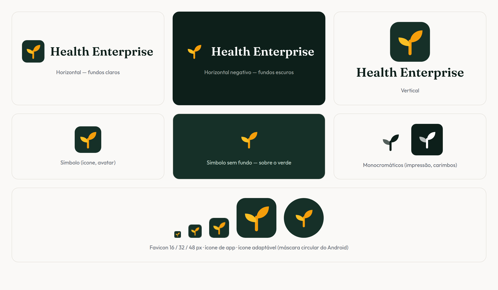
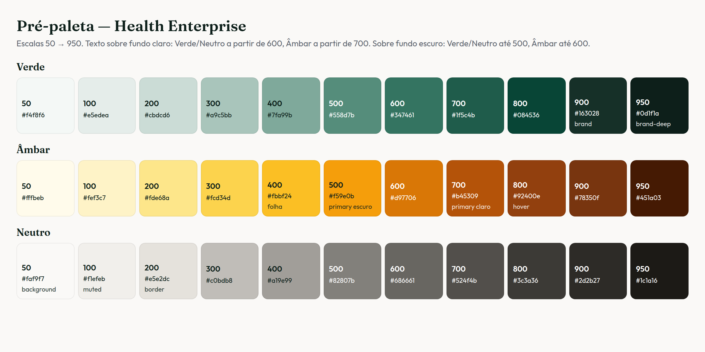

# Identidade Visual — Health Enterprise (HE)

> *A saúde do seu negócio, visual e sob controle.*

**Versão 2 — Direção "Balcão" (SPEC-016, 10/2026).** A versão 1 (02/10/2026: off-white quente, botão âmbar, Fraunces + Outfit) continua no histórico do repositório. Protótipo aprovado da Direção B: quadro "HE — Direções visuais", linha B (14/10/2026).

Guia da identidade visual do produto. Todos os arquivos citados estão em `docs/design/`. A implementação vive em `src/app/globals.css` (tokens), `src/components/ui/` (componentes) e `src/components/graficos/` (gráficos).

---

## 1. Conceito

| Elemento | Decisão |
|---|---|
| **Nome** | **Health Enterprise** — abreviado como **HE** em espaços pequenos. |
| **Símbolo** | **Broto saudável**: um broto crescendo, que representa o negócio saudável que se desenvolve. As folhas em âmbar remetem a dinheiro e energia; o verde-escuro, a estabilidade. |
| **Direção visual** | **"Balcão"**: a estrutura do app (menu, barra inferior, faixa do caixa) em verde-escuro, o conteúdo sobre um fundo neutro levemente frio, ações em verde e o âmbar **só** como destaque da marca. Uma fonte só, a **Manrope**. |
| **Assinatura** | A **faixa do caixa**: saldo, tendência dos últimos 30 dias e a saúde do mês, no topo de todas as telas para quem vê o Dashboard completo. É o que torna o produto reconhecível. |
| **Personalidade** | Simples, acolhedor e confiável. Sem jargão contábil: o público (personas Camila, Thiago, Gisele e Lucas) quer clareza, não termos técnicos. |

---

## 2. Logo

### 2.1 Arquivos (`identidade/logo/`)

| Arquivo | Uso |
|---|---|
| `he-logo-horizontal.svg` / `.png` | Padrão em fundos claros (documentos, telas públicas no tema claro). |
| `he-logo-horizontal-negativo.svg` / `.png` | Fundos escuros (estrutura do app, painel das telas de acesso, tema escuro). Usa o broto **sem** o quadrado. |
| `he-logo-vertical.svg` / `.png` | Telas de abertura, capas de apresentação. |
| `he-simbolo.svg` / `he-simbolo-512.png` | Ícone isolado, avatar, menu recolhido. |
| `he-simbolo-sem-fundo.svg` | Símbolo sobre o verde da marca. |
| `he-simbolo-mono-verde.svg` / `he-simbolo-mono-branco.svg` | Impressão em uma cor, carimbos, marca-d'água. |

O texto "Health Enterprise" dos SVGs está convertido em contornos (não depende da fonte instalada).

### 2.2 Regras de uso

- **Área de proteção:** mantenha ao redor do logo um espaço livre igual a 1/4 da altura do símbolo.
- **Tamanho mínimo:** símbolo com 24 px; logo horizontal com 120 px de largura.
- **Não fazer:** distorcer, girar, trocar as cores das folhas, aplicar sombra ou contorno, colocar o logo com quadrado sobre fundo verde-escuro (use a versão negativa) ou sobre fotos sem uma área de fundo sólido.

### 2.3 Favicon e ícones de app (`identidade/favicon/`)

`favicon.svg`, `favicon.ico` (16/32/48 px), `favicon-16/32/48.png`, `apple-touch-icon.png` (180 px), `icon-192.png`, `icon-512.png`, `icon-maskable-512.png` e `site.webmanifest`. O `theme-color` do app é a cor da estrutura, `#12342c`.

---

## 3. Cores

As cores são **tokens** em [`identidade/tokens/tokens.css`](identidade/tokens/tokens.css), copiados para `src/app/globals.css` (o teste `test/unit/tokens.test.ts` confere que são idênticos). Use sempre o **token** (ex.: `bg-primary`, `text-muted-foreground`), nunca o código hex no componente — o teste `test/unit/design-system.test.ts` recusa hex, `rgb()` e `rgba()` nas telas.

### 3.1 Tema claro

| Token | Hex | Uso |
|---|---|---|
| `background` | `#eef3f1` | Fundo das telas (neutro levemente frio) |
| `card` | `#ffffff` | Superfícies (cartões), campos, gavetas |
| `foreground` | `#12201c` | Texto principal |
| `muted` / `muted-foreground` | `#e4ece8` / `#5a6863` | Preenchimentos discretos (trilhos, segmentos) / texto de apoio |
| `primary` / `primary-hover` | `#1d6a51` / `#134e3b` | Ação principal, links, foco |
| `border` / `input` / `ring` | `#dce3e0` / `#7a8882` / `#1d6a51` | Divisórias, borda de campos, anel de foco |
| `destructive` | `#b42318` | Erros e ações destrutivas |
| `estrutura` / `estrutura-foreground` / `estrutura-suave` | `#12342c` / `#ffffff` / `#a9c2b9` | Menu, barra inferior, faixa do caixa, destaques escuros |
| `ambar` / `ambar-foreground` | `#f5a524` / `#1f1500` | **Só destaque da marca**: "Vender", "Finalizar venda", item ativo do menu, selo "Plano pago" |

### 3.2 Tema escuro

| Token | Hex | Uso |
|---|---|---|
| `background` / `card` / `muted` | `#0b1714` / `#12241f` / `#1a2e28` | Fundo, superfícies, preenchimentos |
| `foreground` / `muted-foreground` | `#ecebe7` / `#a7b0ab` | Texto principal e de apoio |
| `primary` / `primary-hover` | `#3dbf93` / `#62d3ab` | Ação principal (texto escuro sobre ele) |
| `border` / `input` / `ring` | `#24392f` / `#6f817a` / `#f5a524` | Divisórias, campos, foco |
| `destructive` | `#f87171` | Erros |
| `estrutura` / `estrutura-suave` | `#0f2a23` / `#9db8ae` | Estrutura do app |

O tema escuro foi definido **cor a cor**, e não invertendo o claro. Ele é ativado pela classe `.dark` no `<html>`, aplicada antes da pintura a partir da escolha gravada (`he-tema`); o botão de tema existe no menu e nas telas públicas.

### 3.3 Contraste verificado

Todos os pares de texto e de interface foram medidos pela WCAG 2.1: **4,5:1** para texto e **3:1** para bordas, foco e marcas de gráfico. São **48 pares nos dois temas, todos OK**; o script [`identidade/tokens/validar_contraste.py`](identidade/tokens/validar_contraste.py) refaz a verificação e deve ser executado sempre que uma cor mudar. Destaques: texto sobre o fundo 14,99:1; branco sobre o verde de ação 6,50:1; âmbar sobre a estrutura 6,62:1; texto escuro sobre o âmbar 8,83:1.

Além do script, a varredura **axe** (WCAG 2.1 A/AA) roda em todas as telas, nos dois temas, sem nenhuma violação grave ou crítica (evidências da SPEC-016).

### 3.4 Pré-paleta

Escalas de 50 a 950 nas famílias **Verde**, **Âmbar** e **Neutro** — a fonte de novos tons, sem inventar cores fora delas. Quando um tom passar a ter papel fixo na interface, crie um token semântico e rode `validar_contraste.py`. Arquivos: [`pre-paleta.json`](identidade/tokens/pre-paleta.json) e [`tokens-design-system.json`](identidade/tokens/tokens-design-system.json).

---

## 4. Semáforo de saúde financeira (RF57)

| Status | Ícone | Texto / fundo (claro) | Texto / fundo (escuro) |
|---|---|---|---|
| **Saudável** | ✓ (check) | `#166534` / `#e8f5ec` | `#4ade80` / `#123524` — 7,72:1 |
| **Atenção** | ⚠ (triângulo) | `#8a5a00` / `#fdf6d8` | `#facc15` / `#3a3110` — 8,43:1 |
| **Déficit** | ↓ (seta para baixo) | `#b42318` / `#fdeceb` | `#f87171` / `#3b1717` — 5,75:1 |

**Regra:** o status **nunca é comunicado só pela cor** — sempre ícone + rótulo escrito. O componente é o `Selo` (`src/components/ui/selo.tsx`, tons `ok`, `atencao`, `perigo`, `neutro`, `info`). As cores de status são **reservadas**: não servem para séries de gráficos nem para decoração.

---

## 5. Gráficos

### 5.1 Paleta

| Série | Claro | Escuro |
|---|---|---|
| 1 | `#0b8a68` | `#1fae86` |
| 2 | `#cf6d0c` | `#c97212` |
| 3 | `#2a78d6` | `#3987e5` |
| 4 | `#d55181` | `#d55181` |
| 5 | `#4a3aa7` | `#9085e9` |
| Contexto (`chart-neutro`) | `#84948d` | `#647770` |

Validada nos dois temas (daltonismo, visão normal, luminosidade, contraste ≥ 3:1 com o cartão). A série de contexto serve para "o resto" quando poucos itens estão em destaque.

**Série 6 (SPEC-024, aprovada em 26/10/2026):** a barra "Para onde vai cada venda" da Calculadora passa a ter seis partes (custo, despesas fixas, maquininha, comissão, imposto e margem). A 6ª cor é escolhida na implementação, com a mesma validação nos dois temas, e entra nesta tabela junto com ela.

### 5.2 Regras (todas)

- Cores **sempre na mesma ordem**, seguindo a entidade (um filtro não repinta o que sobra); no máximo 6 séries (eram 5 até a SPEC-024).
- **Um único eixo vertical.** Entradas e saídas aparecem acima e abaixo da linha do zero — a posição separa, a cor só reforça.
- Valores e rótulos na cor do texto, nunca na cor da série; legenda com 2 ou mais séries; rótulo direto só onde importa (ex.: o menor saldo da projeção).
- **Balão** com o valor ao passar o mouse, tocar ou focar pelo teclado (um quadro acima do gráfico, região viva para leitores de tela); área de toque maior que a marca.
- **"Ver os valores"**: toda figura tem a tabela com os mesmos números.
- Desenhados em SVG no servidor; no navegador, só a camada do balão.

### 5.3 Catálogo de gráficos

| Gráfico | Componente | Onde |
|---|---|---|
| Vendas (30 dias / 12 meses), com média, parcial hachurado e ano anterior | `GraficoDeBarras` | Painel, Vendas |
| Meta do mês (faturado, ritmo, equilíbrio, meta) | `Medidor` | Painel |
| Caixa nos próximos meses | `GraficoDeProjecao` / `ProjecaoDoCaixa` | Painel, Financeiro |
| Fluxo do mês, por dia | `GraficoDeFluxo` | Financeiro |
| Como os clientes pagam; para onde vai cada venda | `BarraEmpilhada` | Painel, Relatórios, Calculadora |
| O que mais deixa lucro | `BarrasHorizontais` | Painel, Relatórios |
| Tendência do saldo | `Minigrafico` | Faixa do caixa, telas de acesso (ilustração) |

---

## 6. Tipografia

Uma família só: **Manrope** (sem serifa, geométrica e legível em números), servida pelo próprio app com `next/font` — sem chamada ao Google em tempo de execução.

| Papel | Tamanho / peso |
|---|---|
| Título de tela | 28 px, 800 (`text-[28px] font-extrabold`) |
| Título de superfície | 17 px, 700 |
| Número de destaque | 32–46 px, 800, algarismos tabulares (`Numero`) |
| Texto | 14–15 px, 400–600 |
| Apoio | 12–13 px, cor `muted-foreground` |

Valores monetários e quantidades usam `tabular-nums`. Linhas de texto corrido com até ~72 caracteres (documentos legais).

---

## 7. Estrutura do app e componentes

### 7.1 Estrutura

| Largura | Navegação |
|---|---|
| ≥ 1024 px | Menu lateral verde-escuro com módulos, configurações e o seletor de negócio; pode ser recolhido para ícones (SPEC-016, N8) |
| 640–1023 px | Trilho só com ícones, com o nome de cada item numa dica |
| < 640 px | Barra superior + barra inferior flutuante: Painel, Vendas, **Vender** (âmbar), Caixa (ou Estoque) e Mais (gaveta) |

A **faixa do caixa** fica no topo de todas as telas (versão compacta) e em destaque no Painel (versão grande), só para quem vê o Dashboard completo. Depois de uma venda, o saldo ganha um destaque curto (o "momento-assinatura").

### 7.2 Componentes (`src/components/ui/`)

| Componente | Para quê |
|---|---|
| `classeDoBotao(variante, tamanho)` | Botões em pílula: `principal`, `secundario`, `perigo`, `fantasma`, `ambar`, `na-estrutura` |
| `Superficie` / `TituloDaSuperficie` | Cartões por hierarquia: `cartao` (20 px), `estrutura` (24 px, destaque escuro), `recuo`, `atencao`, `perigo` — sem borda nem sombra repetidas |
| `CabecalhoDePagina` | Título, descrição, ações e o "voltar" |
| `Numero` | Número de destaque com rótulo e detalhe |
| `Selo` | Status com ícone + texto |
| `AvisoDaPagina` | Aviso na tela (sucesso, erro, atenção, informação) |
| `avisar()` / `AvisosFlutuantes` | Confirmação flutuante depois de uma ação, com o mesmo verbo do botão |
| `Segmentos` | Filtros e visões como links (funcionam sem JavaScript e mantêm a URL) |
| `EstadoVazio` / `Esqueleto` | Tela vazia que convida à ação; carregamento |
| `Gaveta` / `GavetaDaRota` | Formulários curtos por cima da tela, com URL própria (rotas interceptadas) |

Raio: 20 px nas superfícies, 24 px nos destaques escuros, 16 px nos recuos; pílula em botões e segmentos.

### 7.3 Movimento

Tokens: `--duracao-toque` 120 ms, `--duracao-estado` 220 ms, `--duracao-layout` 360 ms e a curva `--ease-saida`. Só três usos: resposta ao toque (botão encolhe a 96%), troca de estado e a entrada da gaveta e da faixa. Nada de entradas em cascata, rolagem animada ou efeitos "elásticos". Com `prefers-reduced-motion`, **nenhuma animação** acontece.

---

## 8. Escrita da interface

- Frases curtas e verbos simples; maiúscula só no começo da frase. **Nada de rótulos em MAIÚSCULAS** nem rótulos decorativos acima dos títulos.
- Informações juntas por vírgula ou em linhas, não por "·".
- O botão diz o que acontece ("Finalizar venda", "Registrar entrada") e a confirmação repete o verbo ("Venda registrada", "Entrada registrada").
- Erros dizem o que aconteceu e como resolver, sem pedir desculpas; telas vazias convidam à ação ("Cadastrar o primeiro item").

---

## 9. Telas de acesso

O painel da esquerda usa a cor da estrutura, com o slogan e uma **faixa do caixa de exemplo** como ilustração (valores fictícios, anunciados como exemplo para leitores de tela); o formulário fica ao lado e, no celular, sozinho. Login só por e-mail e senha (RF01, ADR-003). O protótipo da versão 1 continua em [`prototipo_revisado/`](prototipo_revisado/) como referência histórica.

---

## 10. Aplicação

- **SPEC-001/002:** tokens, favicon, metadados e as telas de acesso (versão 1).
- **SPEC-012:** semáforo e os primeiros gráficos.
- **SPEC-016:** versão 2 — tokens v2, Manrope, componentes de interface e de gráfico, estrutura do app, faixa do caixa e as 40 telas migradas.
- Qualquer cor nova entra como token e passa por `validar_contraste.py`; qualquer tela nova usa os componentes de `src/components/ui/` (o teste de varredura recusa estilos escritos à mão).
