# Modelo Lógico de Banco de Dados (DER) — HE (HealthEnterprise)

> **Atualizado em 07/11/2026** (SPEC-019, etapa 4b) com o que entrou até a SPEC-019: fornecedores, histórico de custo, histórico do plano, acesso e registro do suporte, pedidos da plataforma, suspensão do negócio e os campos novos de usuário, negócio, item e financeiro. O `prisma/schema.prisma` continua sendo a fonte da verdade.

Este documento especifica a estrutura relacional do banco de dados (Modelo Lógico) do sistema **HealthEnterprise (HE)**, derivado do Modelo de Domínio Conceitual e preparado para a implementação no Prisma ORM (PostgreSQL).

---

## 📊 Diagrama Entidade-Relacionamento (ER)

> **Dica de Renderização:** O GitHub renderiza o bloco abaixo automaticamente nas páginas do repositório.

```mermaid
erDiagram
    USUARIO ||--o{ MEMBRO_NEGOCIO : "participa_como"
    NEGOCIO ||--o{ MEMBRO_NEGOCIO : "possui"
    NEGOCIO ||--o{ ITEM : "cadastra"
    NEGOCIO ||--o{ SUBCATEGORIA : "organiza"
    SUBCATEGORIA |o--o{ ITEM : "agrupa"
    NEGOCIO ||--o{ CLIENTE : "atende"
    NEGOCIO ||--o{ VENDA : "registra"
    NEGOCIO ||--o{ LANCAMENTO_FINANCEIRO : "mantem"
    NEGOCIO ||--o{ CONTA_PAGAR_RECEBER : "mantem"
    NEGOCIO ||--o{ DESPESA_FIXA : "possui"
    NEGOCIO ||--o{ CONVITE : "envia"
    USUARIO ||--o{ CONVITE : "convida"
    USUARIO |o--o{ NEGOCIO : "altera_plano"

    ITEM ||--o{ HISTORICO_PRECO : "acumula"
    USUARIO ||--o{ HISTORICO_PRECO : "confirma"
    ITEM ||--o{ MATERIAL_SERVICO : "servico_consome"
    ITEM ||--o{ MATERIAL_SERVICO : "material_utilizado_em"
    ITEM ||--o{ MOVIMENTACAO_ESTOQUE : "registra"
    USUARIO ||--o{ MOVIMENTACAO_ESTOQUE : "executa"
    VENDA |o--o{ MOVIMENTACAO_ESTOQUE : "baixa_e_estorna"

    CLIENTE |o--o{ VENDA : "associa"
    VENDA ||--|{ ITEM_VENDA : "contem"
    ITEM ||--o{ ITEM_VENDA : "compoe"
    VENDA ||--|{ PAGAMENTO : "recebe"
    VENDA |o--o{ LANCAMENTO_FINANCEIRO : "gera"
    PAGAMENTO ||--o{ PARCELA : "gera_se_credito"
    PARCELA |o--o| CONTA_PAGAR_RECEBER : "origina"
    CONTA_PAGAR_RECEBER |o--o{ LANCAMENTO_FINANCEIRO : "quitada_por"
    CNAE_ANEXO ||..o{ NEGOCIO : "sugere_anexo"
    NCM |o..o{ ITEM : "classifica_pelo_codigo"
    DESPESA_FIXA |o--o{ CONTA_PAGAR_RECEBER : "gera_mensalmente"
    VENDA |o--o| VENDA : "troca_de"
    USUARIO |o--o{ VENDA : "cancela"

    NEGOCIO ||--o{ FORNECEDOR : "compra_de"
    FORNECEDOR |o--o{ CONTA_PAGAR_RECEBER : "recebe_pagamento"
    FORNECEDOR |o--o{ DESPESA_FIXA : "fornece"
    CLIENTE |o--o{ CONTA_PAGAR_RECEBER : "deve"
    ITEM ||--o{ HISTORICO_CUSTO : "acumula"
    USUARIO |o--o{ HISTORICO_CUSTO : "altera"
    NEGOCIO ||--o{ HISTORICO_PLANO : "troca_plano"
    USUARIO ||--o{ HISTORICO_PLANO : "troca"
    PEDIDO_PLATAFORMA |o--o{ HISTORICO_PLANO : "origina"
    USUARIO |o--o{ NEGOCIO : "suspende"

    NEGOCIO ||--o{ ACESSO_SUPORTE : "libera"
    USUARIO |o--o{ ACESSO_SUPORTE : "libera_ou_revoga"
    PEDIDO_PLATAFORMA |o--o| ACESSO_SUPORTE : "cria_emergencia"
    NEGOCIO |o--o{ REGISTRO_SUPORTE : "audita"
    ACESSO_SUPORTE |o--o{ REGISTRO_SUPORTE : "registra"
    USUARIO ||--o{ REGISTRO_SUPORTE : "autor"
    REGISTRO_SUPORTE |o--o| REGISTRO_SUPORTE : "desfaz_correcao"
    PEDIDO_PLATAFORMA |o--o{ REGISTRO_SUPORTE : "registra"
    NEGOCIO ||--o{ PEDIDO_PLATAFORMA : "recebe"
    USUARIO ||--o{ PEDIDO_PLATAFORMA : "pede_ou_decide"

    NEGOCIO {
        uuid id PK
        string nome
        enum regime_tributario "MEI | SIMPLES_NACIONAL | AUTONOMO"
        enum plano "GRATUITO | PAGO"
        datetime plano_alterado_em
        uuid plano_alterado_por_id FK
        string cnpj UK "opcional"
        string razao_social
        string cnae_principal
        enum anexo_simples "I..V, so Simples"
        boolean sujeito_fator_r
        enum atividade_mei "so MEI"
        decimal imposto_percentual_manual "so AUTONOMO"
        decimal taxa_cartao_media
        decimal margem_lucro_meta
        decimal capacidade_mensal
        decimal ticket_medio_estimado
        decimal faturamento_mensal_estimado
        decimal cmv_estimado
        int dias_cobertura_estoque
        boolean emite_nota_de_produto "padrao falso (SPEC-021)"
        int proximo_numero_venda
        datetime encerrado_em
        date eliminar_apos "encerramento + 5 anos (SPEC-014)"
        datetime suspenso_em "SPEC-019: so leitura"
        uuid suspenso_por_id FK "Administrador"
        enum motivo_suspensao "PEDIDO_DO_DONO | USO_INDEVIDO | INCIDENTE_SEGURANCA | ORDEM_JUDICIAL"
        string descricao_suspensao "ate 500"
        datetime created_at
    }

    USUARIO {
        uuid id PK "= auth.users.id (Supabase)"
        string nome
        string email UK
        datetime consentimento_lgpd_em
        string versao_termos_aceita
        datetime termos_aceitos_em
        datetime excluido_em
        datetime anonimizado_em
        datetime credencial_removida_em "SPEC-014"
        datetime administrador_em "SPEC-018: papel de Administrador"
        datetime segundo_fator_redefinido_em "SPEC-019"
    }

    MEMBRO_NEGOCIO {
        uuid id PK
        uuid usuario_id FK
        uuid negocio_id FK
        enum papel "DONO | GERENTE | COLABORADOR"
        json permissoes_custom
        datetime suspenso_em "limite do plano gratuito (SPEC-013)"
    }

    CONVITE {
        uuid id PK
        uuid negocio_id FK
        string email
        enum papel "DONO | GERENTE | COLABORADOR"
        json permissoes_custom
        string token_hash UK
        enum status "PENDENTE | ACEITO | EXPIRADO | CANCELADO"
        datetime expira_em
        uuid convidado_por_id FK
        datetime respondido_em
    }

    CLIENTE {
        uuid id PK
        uuid negocio_id FK
        enum tipo "PESSOA_FISICA | PESSOA_JURIDICA (SPEC-022)"
        string nome "nome ou razao social"
        string nome_fantasia "so empresa"
        string documento "CPF 11 ou CNPJ 14, unico no negocio"
        enum situacao_ie "CONTRIBUINTE | ISENTO | NAO_CONTRIBUINTE"
        string inscricao_estadual "so CONTRIBUINTE"
        string inscricao_municipal "so empresa"
        string nome_contato "so empresa"
        string email
        string telefone
        string cep
        string logradouro
        string numero
        string complemento
        string bairro
        string municipio
        string uf
        datetime criado_em
        datetime atualizado_em
        datetime anonimizado_em
    }

    ITEM {
        uuid id PK
        uuid negocio_id FK
        enum tipo "PRODUTO_FISICO | SERVICO"
        string nome
        enum categoria "lista fixa RF11"
        uuid subcategoria_id FK "opcional, mesma categoria (SPEC-020)"
        string unidade_medida
        decimal custo_base
        decimal preco_atual "null = nao vendavel"
        decimal quantidade_estoque "so PRODUTO_FISICO"
        decimal estoque_minimo "opcional"
        decimal comissao_percentual "opcional"
        string ncm "8 digitos, opcional, so PRODUTO_FISICO (SPEC-021)"
        string codigo "codigo interno, unico entre os ativos (SPEC-024)"
        datetime arquivado_em
    }

    HISTORICO_CUSTO {
        uuid id PK
        uuid negocio_id FK
        uuid item_id FK
        decimal custo
        datetime vigente_desde
        uuid usuario_id FK "quem alterou (SPEC-025)"
    }

    FORNECEDOR {
        uuid id PK
        uuid negocio_id FK
        enum tipo "PESSOA_FISICA | PESSOA_JURIDICA (SPEC-026)"
        string nome "nome ou razao social"
        string nome_fantasia
        string documento "CPF ou CNPJ, unico no negocio"
        enum situacao_ie
        string inscricao_estadual
        string inscricao_municipal
        string nome_contato
        string email
        string telefone
        string cep
        string logradouro
        string numero
        string complemento
        string bairro
        string municipio
        string uf
        datetime anonimizado_em
    }

    SUBCATEGORIA {
        uuid id PK
        uuid negocio_id FK
        enum categoria "lista fixa RF11; nao muda"
        string nome "ate 40"
        string nome_chave "unico com negocio e categoria"
        datetime criada_em
    }

    MATERIAL_SERVICO {
        uuid id PK
        uuid negocio_id FK
        uuid servico_id FK
        uuid material_id FK
        decimal quantidade
    }

    MOVIMENTACAO_ESTOQUE {
        uuid id PK
        uuid negocio_id FK
        uuid item_id FK
        uuid venda_id FK "opcional"
        uuid usuario_id FK
        enum tipo "ENTRADA | SAIDA_VENDA | SAIDA_MANUAL | ENTRADA_ESTORNO"
        decimal quantidade
        decimal saldo_anterior
        decimal saldo_posterior
        enum motivo "so SAIDA_MANUAL"
        datetime data
    }

    HISTORICO_PRECO {
        uuid id PK
        uuid negocio_id FK
        uuid item_id FK
        uuid usuario_id FK
        decimal preco
        enum origem "CALCULADORA | MANUAL"
        decimal margem_aplicada
        decimal custo_considerado
        decimal despesas_fixas_percentual
        decimal despesas_variaveis_percentual
        enum regime_tributario
        decimal imposto_aplicado
        datetime data_confirmacao
    }

    FAIXA_TRIBUTARIA {
        uuid id PK
        enum anexo "I..V"
        int faixa_ordem
        decimal rbt12_de "exclusivo"
        decimal rbt12_ate "inclusivo"
        decimal aliquota
        decimal parcela_deduzir
        string fonte_legal
        datetime vigente_desde
        boolean ativo
    }

    NCM {
        uuid id PK
        string codigo "8 digitos; unico com vigente_desde"
        string descricao
        string[] caminho "niveis acima"
        string texto_busca "sem acentos"
        date vigente_desde
        date vigente_ate "null = sem fim"
        string ato
    }

    TABELA_NCM {
        int id PK "sempre 1"
        date atualizada_em
        string ato
        datetime carregada_em
    }

    CNAE_ANEXO {
        string cnae PK
        string descricao
        enum anexo
        boolean sujeito_fator_r
        string fonte_legal
        datetime vigente_desde
    }

    PARAMETRO_FATOR_R {
        uuid id PK
        decimal limite_minimo
        enum anexo_se_atingir
        enum anexo_se_nao_atingir
        string fonte_legal
        datetime vigente_desde
        boolean ativo
    }

    PARAMETRO_MEI {
        uuid id PK
        enum atividade
        decimal valor_das_mensal
        decimal limite_faturamento_anual
        string fonte_legal
        datetime vigente_desde
        boolean ativo
    }

    MARGEM_PADRAO_CATEGORIA {
        enum categoria PK
        decimal margem_padrao
        string fonte_legal
        datetime vigente_desde
    }

    DESPESA_FIXA {
        uuid id PK
        uuid negocio_id FK
        string descricao
        decimal valor_mensal
        int dia_vencimento
        enum categoria
        enum origem "MANUAL | DAS_MEI"
        boolean ativo
        date gera_desde
        uuid fornecedor_id FK "opcional (SPEC-026)"
        datetime created_at
    }

    VENDA {
        uuid id PK
        uuid negocio_id FK
        uuid cliente_id FK "opcional"
        decimal valor_total
        datetime data
        enum status "CONCLUIDA | CANCELADA"
        datetime cancelada_em
        uuid cancelada_por_id FK
        string motivo_cancelamento
        uuid venda_origem_id FK "UK, troca"
    }

    ITEM_VENDA {
        uuid id PK
        uuid negocio_id FK
        uuid venda_id FK
        uuid item_id FK
        decimal quantidade
        decimal preco_unitario
        decimal custo_unitario
    }

    PAGAMENTO {
        uuid id PK
        uuid negocio_id FK
        uuid venda_id FK
        enum forma "DINHEIRO | PIX | DEBITO | CREDITO | CREDITO_TROCA"
        decimal valor
        int parcelas
    }

    PARCELA {
        uuid id PK
        uuid negocio_id FK
        uuid pagamento_id FK
        int numero
        decimal valor
        datetime vencimento
    }

    LANCAMENTO_FINANCEIRO {
        uuid id PK
        uuid negocio_id FK
        uuid venda_id FK "opcional"
        uuid conta_id FK "opcional"
        enum tipo "ENTRADA | SAIDA"
        enum categoria "VENDAS | FORNECEDORES | IMPOSTOS | SALARIO | OUTROS"
        enum origem
        string descricao
        decimal valor
        boolean estorno
        uuid estorno_de_id FK "opcional"
        enum forma_pagamento "SPEC-026"
        uuid usuario_id FK "quem registrou"
        datetime data
    }

    CONTA_PAGAR_RECEBER {
        uuid id PK
        uuid negocio_id FK
        uuid parcela_id FK "UK, opcional"
        uuid despesa_fixa_id FK "opcional"
        datetime competencia "UK com despesa_fixa_id"
        enum tipo "PAGAR | RECEBER"
        enum categoria
        string descricao
        decimal valor_total
        decimal valor_pago
        datetime vencimento
        enum status "ABERTA | PARCIAL | QUITADA | CANCELADA"
        uuid fornecedor_id FK "so PAGAR (SPEC-026)"
        uuid cliente_id FK "so RECEBER (SPEC-026)"
        string numero_documento
        uuid criada_por_id FK
    }

    HISTORICO_PLANO {
        uuid id PK
        uuid negocio_id FK
        enum de "GRATUITO | PAGO"
        enum para "GRATUITO | PAGO"
        uuid usuario_id FK "Dono, ou quem aprovou na plataforma"
        string motivo "so pela plataforma (SPEC-019)"
        uuid pedido_id FK "so pela plataforma"
        datetime created_at
    }

    ACESSO_SUPORTE {
        uuid id PK
        uuid negocio_id FK
        enum tipo "LIBERACAO | EMERGENCIA (SPEC-019)"
        uuid liberado_por_id FK "Dono; nulo na emergencia"
        string motivo
        string_array modulos
        string_array modulos_com_correcao "ver e corrigir (SPEC-019)"
        datetime criado_em
        datetime expira_em
        datetime revogado_em
        uuid revogado_por_id FK
        datetime primeira_entrada_em
        enum motivo_emergencia "ORDEM_JUDICIAL | INCIDENTE | DONO_SEM_ACESSO"
        string referencia
        string justificativa
        uuid pedido_id FK "UK, o pedido aprovado"
        string resultado "ate 1000"
        datetime resultado_em
    }

    REGISTRO_SUPORTE {
        uuid id PK
        uuid negocio_id FK "nulo nos eventos da conta"
        uuid acesso_id FK "opcional"
        uuid usuario_id FK "autor"
        enum evento "liberacao, telas, correcoes, emergencia, suspensao, plano, 2o fator"
        string modulo
        string descricao "ate 200"
        json dados "antes e depois, motivo e descricao"
        uuid correcao_id FK "UK, o desfazer aponta a correcao"
        uuid pedido_id FK "opcional"
        datetime criado_em
    }

    PEDIDO_PLATAFORMA {
        uuid id PK
        enum tipo "PLANO | EMERGENCIA"
        uuid negocio_id FK
        uuid solicitado_por_id FK
        json dados "o que foi pedido"
        datetime criado_em
        datetime expira_em "ate 12 h"
        enum situacao "PENDENTE | APROVADO | RECUSADO | CANCELADO | EXPIRADO"
        uuid decidido_por_id FK "outra conta"
        datetime decidido_em
        string motivo_da_recusa
    }
```

### Decisões de modelagem (alinhadas ao `schema.prisma`, que é a fonte da verdade)

| Decisão | Justificativa |
|---|---|
| `negocio_id` em **todas** as tabelas operacionais, inclusive as filhas (`MATERIAL_SERVICO`, `MOVIMENTACAO_ESTOQUE`, `HISTORICO_PRECO`, `ITEM_VENDA`, `PAGAMENTO`, `PARCELA`) | Filtro uniforme pela extensão do Prisma Client e RLS ligado no banco (ADR-002, OPEN-12); o valor é sempre igual ao do registro pai. |
| `USUARIO.id` = `auth.users.id`, sem senha | A credencial fica só no Supabase Auth (ADR-003, OPEN-14). |
| `ITEM` em tabela única com coluna `tipo` (sem tabelas `PRODUTO_FISICO`/`SERVICO`) | Simplifica consultas de catálogo e vendas; campos de estoque só são válidos quando `tipo = PRODUTO_FISICO` (RN04, validado na aplicação). |
| `categoria` como enum (sem tabela `CATEGORIA`) | A lista de categorias é fixa do sistema (RF11). |
| `SUBCATEGORIA` do negócio, com `ITEM.subcategoria_id` opcional | Subcategorias livres dentro de cada categoria fixa (RF79, SPEC-020): nome único por negócio e categoria; a categoria da subcategoria é a do item (gatilho) e não muda; excluir deixa `subcategoria_id` nulo nos itens (`ON DELETE SET NULL`). A margem continua por categoria (RN33). |
| `ITEM.ncm` sem chave estrangeira, e as tabelas globais `NCM` e `TABELA_NCM` | O código fica no item mesmo depois de sair da tabela, com aviso de revisão (SPEC-021, OPEN-002); `CHECK` de 8 dígitos e de que só `PRODUTO_FISICO` tem NCM. `NCM` é a tabela oficial do Siscomex, com vigência e sem `negocio_id`, carregada de arquivo versionado como os parâmetros fiscais (ADR-004); a carga nunca apaga códigos. `TABELA_NCM` tem uma linha com a data e o ato do arquivo carregado. As duas têm RLS ligado, sem políticas. `NEGOCIO.emite_nota_de_produto` torna o NCM obrigatório e tira da venda o produto sem NCM (RF80, RN35). |
| `CLIENTE` com documento, inscrições, contato e endereço, todos opcionais além do nome | Dados do destinatário da nota fiscal (RF81, SPEC-022). `CHECK` de formato e de coerência com o tipo (CPF só em pessoa física, CNPJ com letras ou dígitos só em empresa; campos de empresa só em empresa; número da inscrição estadual só com `CONTRIBUINTE`; CEP de 8 dígitos; UF da lista). Índice único `(negocio_id, documento)`: ao anonimizar, o documento fica nulo, e o Postgres aceita vários nulos, então a unicidade vale entre os ativos. `Cliente_anonimizado_sem_dados` garante que o anonimizado não guarda nenhum dado pessoal (RN27, RN36). O antigo `contato` foi migrado para `email` ou `telefone` e removido. |
| `MATERIAL_SERVICO` referencia `ITEM` duas vezes | `servico_id` aponta para um item `SERVICO` e `material_id` para um item `PRODUTO_FISICO` (RF12). |
| `VENDA` 1:N `LANCAMENTO_FINANCEIRO` | Pagamento misto pode gerar mais de um lançamento imediato (RN09). |
| `PARCELA` 1:1 `CONTA_PAGAR_RECEBER` | Cada parcela de cartão gera sua própria conta a receber com vencimento mensal (RN10, RF28). A parcela não tem status próprio: a situação é o status da conta (RN22). |
| `VENDA.status` + `VENDA.venda_origem_id` | Venda nunca é apagada; cancelamento muda o status (RN25) e a troca gera nova venda ligada à original (RF66, RN26). |
| `DESPESA_FIXA` 1:N `CONTA_PAGAR_RECEBER` | Uma conta a pagar por mês (`competencia`), com unicidade `(despesa_fixa_id, competencia)` (RF67). |
| Campos `excluido_em` / `anonimizado_em` / `encerrado_em` | Exclusão de conta por anonimização com retenção fiscal de 5 anos (RN27). |
| `CONTA_PAGAR_RECEBER` 1:N `LANCAMENTO_FINANCEIRO` | Cada pagamento/recebimento (total ou parcial) gera um lançamento no caixa (RN22, RN14). |
| `ITEM.preco_atual` opcional + `HISTORICO_PRECO.origem` | Preço nasce de confirmação via Calculadora ou manual (RF64); item sem preço não é vendável (RN23). |
| `ITEM_VENDA.custo_unitario` | Custo gravado na venda para apurar o CMV% (RF62) usado no PE e na Meta (RF55, RF56). |
| Tabelas de parâmetros fiscais (`FAIXA_TRIBUTARIA`, `CNAE_ANEXO`, `PARAMETRO_MEI`, `MARGEM_PADRAO_CATEGORIA`) | Valores oficiais parametrizáveis com fonte legal e vigência, sem `negocio_id` (globais do sistema) — RN17, RF36, RF59, RF60. |
| `MOVIMENTACAO_ESTOQUE.venda_id` + `saldo_anterior`/`saldo_posterior` | O cancelamento devolve exatamente o que a venda baixou (RN25); a tabela é o próprio log de auditoria, somente INSERT (RNF05, OPEN-20/21). |
| `CONVITE` | Convidado pode ainda não ter conta; pendentes contam no limite do plano gratuito (RF72, RF47). |
| `PARAMETRO_FATOR_R` | Limite de 28% e anexos III/V parametrizados como os demais dados fiscais (RN17, RF69). |
| Faixa: `rbt12_de` exclusivo, `rbt12_ate` inclusivo | Limites contínuos, sem buraco de centavos entre faixas (RF38, OPEN-16). |
| Regime `AUTONOMO` + `imposto_percentual_manual` | Autônomo sem CNPJ informa o próprio Imposto% (RF59, OPEN-18). |
| Status "Atrasada" não persistido | É derivado: `vencimento < hoje` e `valor_pago < valor_total`. |
| `DESPESA_FIXA` + parâmetros no `NEGOCIO` | Base do markup completo (RF34, RF48–RF51) e do ponto de equilíbrio/semáforo (RF55–RF57). |
| `FORNECEDOR` como o `CLIENTE`, ligado às contas a pagar e às despesas fixas | Mesmos campos, `CHECK`s e anonimização do cliente (SPEC-026). A conta guarda o fornecedor (a pagar) ou o cliente (a receber) e o nº do documento; excluir um fornecedor com contas apaga só os dados dele (RN27). |
| `HISTORICO_CUSTO` | O custo vigente numa data, com quem alterou, para o inventário (SPEC-025); só inclusão. |
| `HISTORICO_PLANO` com `motivo` e `pedido_id` | Toda troca de plano fica registrada; a troca pela plataforma aponta o pedido aprovado e guarda a descrição (`CHECK`: os dois juntos — SPEC-013, SPEC-019). |
| `USUARIO.administrador_em` (sem tabela de papéis) | O papel de Administrador da plataforma é concedido só pelo script, a contas sem negócio (SPEC-018). O 2º fator fica no Supabase Auth (`auth.mfa_factors`); o HE guarda só quando ele foi redefinido (SPEC-019). |
| `ACESSO_SUPORTE.tipo` | A liberação do Dono e o acesso de emergência usam a mesma tabela e o mesmo contexto. `CHECK` por tipo: a emergência nasce de um pedido aprovado, sem correção e com até 4 h; a liberação com correção, até 12 h (SPEC-019). |
| `REGISTRO_SUPORTE` só inclusão, com `dados` | Auditoria de tudo o que o suporte e a plataforma fazem, por 5 anos (RN32, INV-011): gatilho `he_somente_insercao`. As correções guardam o antes e o depois em `dados`; o desfazer aponta a correção (`correcao_id`, uma vez só). |
| `PEDIDO_PLATAFORMA` | Pedidos que exigem duas contas de Administrador (troca de plano e emergência): `CHECK` quem pede ≠ quem decide, prazo de 12 h e um pendente por tipo e negócio (INV-006). |
| `NEGOCIO.suspenso_em` + gatilho `he_negocio_suspenso` | Negócio suspenso fica somente leitura: o gatilho recusa a gravação nas tabelas dos módulos e no próprio negócio (menos o plano e a suspensão). Ficam livres a equipe, os convites, o histórico de planos, o suporte e os pedidos (SPEC-019, INV-008). `CHECK`: negócio encerrado não fica suspenso. |

---

## 🖼️ Imagem Exportada
> Imagem gerada a partir do bloco Mermaid acima. Ao alterar o diagrama, regere a imagem (ex.: `npx @mermaid-js/mermaid-cli -i diagrama.mmd -o ../img/modelo_logico_bd.png`).
>
> **Atenção (07/11/2026):** a imagem abaixo é da época da SPEC-013 e ainda não mostra as entidades e os campos acrescentados depois (fornecedores, histórico de custo, histórico do plano, suporte, pedidos da plataforma e suspensão). Até ela ser regerada, a referência é o bloco Mermaid acima, que o GitHub desenha na própria página.

